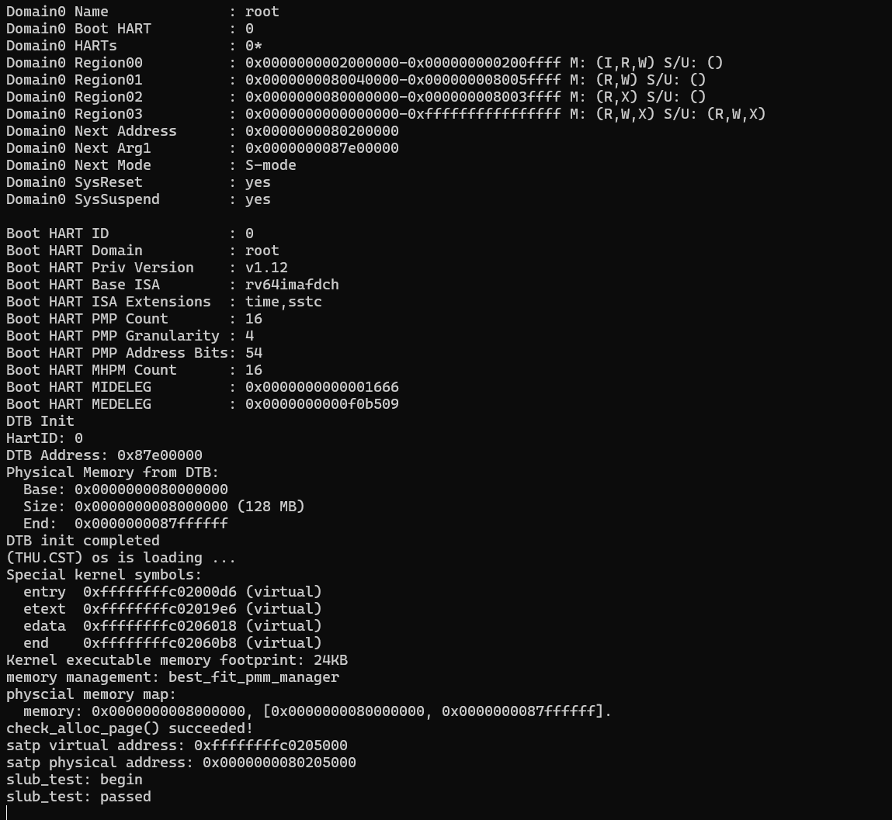
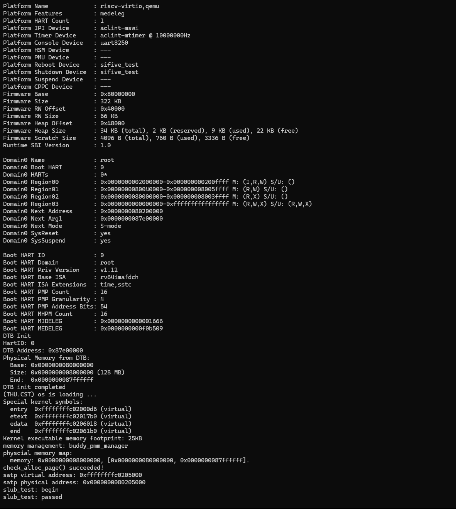

# 实验报告

## 实验基本信息

| 项目 | 内容 |
|------|------|
| **实验名称** | Lab 2: 物理内存和页表 |
| **小组成员** | 2510789-徐康怀、2514022-邓翔予、2510538-张铭瑞 |
| **完成日期** | 2026-10-18 |

### 小组分工

练习如何分工？

| 成员 | 负责的练习/模块 |
|------|----------------|
| 2514022-邓翔予 | 功能模块一 任务一：page_init；功能模块二 任务二：Best-Fit 连续物理内存分配 |
| 2510538-张铭瑞 | 功能模块二 任务三：Buddy System（伙伴系统）分配算法；分支任务：gdb 调试页表查询过程 |
| 2510789-徐康怀 | 功能模块二 任务一：First-Fit 算法分析（思考题）；功能模块一 Challenge：硬件可用物理内存范围获取方法 |

实验报告如何分工？

| 成员 | 负责的章节 |
|------|------------|
| 2514022-邓翔予 | 一、实验目的；三、实验整体逻辑分析；四、功能模块一、功能模块二 Best-Fit；五、测试与验证（page_init、Best-Fit 部分） |
| 2510538-张铭瑞 | 四、Buddy System 两份提示词；四、分支任务 gdb 调试页表；五、测试与验证（Buddy 部分）；六、实验总结与收获（AI 协作开发的经验） |
| 2510789-徐康怀 | 四、First-Fit 算法分析（思考题）；四、Challenge（SLUB）；六、实验总结与收获（知识点对照、未覆盖知识点） |

> ⚠️ 分工为建议方案，需三人确认后填写。

---

## 一、实验目的

本实验的主要目的是：

1. 理解操作系统如何在启动早期发现并接管物理内存，理解"哪些内存能用、哪些必须保留"的划分依据。
2. 理解页表的基本单位与物理内存管理的基本单位之间的关系，掌握用 `Page` 描述符数组管理物理页帧的方法。
3. 理解连续物理内存分配算法的设计取舍，能够实现 First-Fit 与 Best-Fit，并分析其时空代价与碎片行为。
4. 理解伙伴系统（Buddy System）的合并拆分思想与阶（order）管理方法。
5. 学习使用 AI 辅助开发操作系统核心功能：先写需求规格，再让 AI 生成实现。

---

## 二、实验环境

你们使用的 AI 工具

| 成员 | AI 编程工具 | 底层模型 | 备注 |
|------|------------|---------|------|
| 2514022-邓翔予 | WorkBuddy（桌面版） | DeepSeek-V4.1-Flash | 用于阅读提示词模板、编写 lab2 提示词 |
| 2510538-张铭瑞 | WorkBuddy（桌面 agent 平台） | DeepSeek-V4.1-Flash / Kimi-K3 | 用于环境排障、报告撰写与提示词设计 |
| 2510789-徐康怀 | WorkBuddy（桌面 agent 平台） | GLM-5.3-Flash | 用于 First-Fit 思考题分析、SLUB 模块联调验证、QEMU 本地运行排障与报告汇总 |

**说明：**
- **AI 编程工具**：指具体使用的终端工具、编辑器插件、桌面应用或浏览器界面
- **底层模型**：指该工具使用的大语言模型及版本

---

## 三、实验整体逻辑分析

### 2.1 本章节的逻辑主线

本章围绕"**操作系统怎么知道自己有多少内存、哪些能用、怎么管**"展开。

lab1 的内核已经能启动、能打印 `(THU.CST)`，但它回答不了一个最基本的问题：**这台机器上有多少内存？哪块正在用？哪块空闲？** 没有这个问题的答案，后面所有需要内存的功能（进程、虚拟内存、文件系统）都无从谈起。

整个实验要回答的问题是：**内核怎么在加电早期把物理内存"盘点"清楚，并且建立起一套"能分配、能回收"的管理机制？**

**本实验最重要的一个观察**：内存管理的核心矛盾是"**内核自己也在内存里**" —— 它要管理的对象里包含着它自己占用的那部分。所以第一件事不是"分配"，而是"**先搞清楚自己占了哪、还剩哪**"。

### 2.2 功能的逐步实现

1. **先读设备树（`dtb_init`）** → 为什么首先做这个？因为内核自己不知道内存多大，得先问"上一棒"（OpenSBI 通过 `a1` 寄存器传进来的设备树地址）拿到物理内存的起点和大小。**这是所有后续工作的前提。**
2. **再建描述符数组（`page_init`）** → 为什么接着做这个？因为知道内存有多大之后，必须给每一页建一个"档案"（`struct Page`），并把自己和 OpenSBI 占用的部分标记为"保留"，剩下的才允许分配。**先把"不能用"的排除掉，剩下的才是"能分配"的。**
3. **然后实现分配器（`pmm_manager` + First-Fit）** → 为什么然后做这个？有了描述符数组，就要回答"给我一个连续的几页"这个问题。First-Fit 是最朴素的答案：从空闲链表头开始找，第一个够大的就给它。
4. **再换更好的分配器（Best-Fit）** → 为什么最后做这个？First-Fit 的问题是"长期运行后链表头会堆满小碎片"。Best-Fit 的改进只在一处：**找"最小的够用的块"而不是"第一个够大的块"**。因为框架用的是函数指针结构体（`pmm_manager`），换算法只需换指针指向，上层代码一行不用改。
5. **扩展：Buddy System / SLUB** → 为什么选做？这两种算法处理的是更复杂的场景（2 的幂块管理、任意大小对象），属于进阶内容。

---

## 四、实验内容与实现

### 功能模块：物理内存初始化功能

**负责人：** 2514022-邓翔予

#### 模块功能描述

**需要实现/修改的函数：**

```c
static void page_init(void);
```

**功能说明：**

该模块是物理内存管理的**起点**，职责是根据设备树提供的物理内存信息，建立可管理物理页的描述符布局，把排除 OpenSBI、内核镜像和描述符数组占用后的完整空闲页面注册给当前物理内存管理器。

主要场景：
- 物理内存探测：使用设备树提供的内存基址和大小确定物理内存范围
- 描述符布局：建立 `struct Page` 数组，每个物理页对应一个描述符
- 空间排除：OpenSBI、内核镜像、描述符数组自身占用的页面不得进入空闲区

与其他模块的交互：由 `pmm_init()` 调用，在 `init_pmm_manager()` 之后、`check_alloc_page()` 之前执行；`page_init()` 不接收参数也不返回结果。

#### 最终提示词

以下是经过迭代优化后，最终成功实现该功能的提示词：

````markdown
[PROMPT]
在 kern/mm/pmm.c 中实现 page_init()。任务：根据设备树提供的物理内存信息，建立可管理物理页的描述符布局，把排除 OpenSBI、内核镜像和描述符数组占用空间后的完整空闲页面注册给当前物理内存管理器（pmm_manager），为后续页面分配提供正确的初始状态。
操作约束：必须在项目中修改实际文件（kern/mm/pmm.c），保留原有代码，只在标记位置补全；不要引入与本任务无关的功能。
输出要求：使用下方 [RELY]、[GUARANTEE]、[SPECIFICATION] 中提供的信息，以工程真实代码为准。

[RELY]
- 已完成的探测：dtb_init() 已把设备树里的物理内存起点与大小解析并保存到全局变量 memory_base、memory_size（kern/driver/dtb.c）
- 框架提供的函数与宏：get_memory_base()、get_memory_size()、panic()、cprintf()、init_memmap()、pa2page()、set_page_ref()、SetPageReserved()、ClearPageReserved()、PageReserved()、SetPageProperty()、PPN()、PADDR()、KADDR()、ROUNDUP()、PGSIZE、PGSHIFT、DRAM_BASE、KERNBASE
- 全局变量与链接符号：va_pa_offset、npage、pages、nbase，链接符号 end（内核结束的虚拟地址）
- 数据结构：struct Page（kern/mm/memlayout.h）、struct pmm_manager（kern/mm/pmm.h）
- 平台事实：QEMU virt，DRAM 起始物理地址 0x80000000，默认 128MB（即 [0x80000000, 0x88000000)）；OpenSBI 占用 [0x80000000, 0x80200000)；内核镜像占 [0x80200000, KernelEnd)；虚实偏移量 va_pa_offset = 0xFFFFFFFF40000000

[GUARANTEE]
- 交付函数：static void page_init(void)（kern/mm/pmm.c）
- 成功返回时应正确设置三个全局变量：va_pa_offset、npage、pages
- 输出探测到的物理内存范围（调用 cprintf 打印）
- 完成当前物理内存管理器初始空闲区的注册（调用 init_memmap 把空闲区间交出去）

[SPECIFICATION]
前置条件：dtb_init() 已完成；memory_base 与 memory_size 已有效。
行为规格：
1. va_pa_offset = 0xFFFFFFFFC0000000 - 0x80000000（内核虚拟基址与 DRAM 物理基址之差）。
2. npage = PPN(mem_end)，其中 mem_end = memory_base + memory_size - 1。注意：npage 是"物理内存末尾的绝对页号"，不是"页数"；描述符数组的元素个数为 npage - nbase。
3. pages = ROUNDUP((uintptr_t)end, PGSIZE)：描述符数组起点紧接内核结束地址，按页向上对齐。
4. 把描述符数组内每个 Page 先全部置为保留（SetPageReserved），防止未完成布局的页面被提前分配。
5. 空闲起点 freemem = ROUNDUP(PADDR(pages + (npage - nbase)), PGSIZE)：把描述符数组末尾转回物理地址后按页向上对齐。
6. 空闲终点 mem_end 按页向下对齐（去掉末尾不足一页的部分）。
7. 仅当 freemem < mem_end（两者之间存在完整空闲页面区间）时，才调用 init_memmap(pa2page(freemem), (mem_end - freemem) >> PGSHIFT)。
8. 内核镜像与描述符数组所在的页面不得进入空闲区。
失败判据：
- 若 memory_base / memory_size 无效（设备树信息无效），应调用 panic() 终止初始化，不得继续。
- 若 freemem >= mem_end（没有可用的完整空闲页面），不得调用 init_memmap()。
边界情况：页面对齐；末尾不足一页的尾巴不交给分配器。
````

#### 实现迭代过程

> 本节由 2510789-徐康怀 根据最终实现与小组联调记录整理补充。

**迭代 1：npage 语义理解偏差（描述符数组越界）**
初版把 npage 当成"物理内存的页数"来分配描述符数组，数组比实际多出 nbase 项（DRAM 基址 0x80000000 之前的页号），布局后部分保留页被错误注册为可分配。对照指导书明确：**npage 是"物理内存末尾的绝对页号（exclusive）"而非"页数"**，描述符元素个数应为 `npage - nbase`，修正后各处边界一致。

**迭代 2：freemem 忘记转回物理地址**
计算空闲起点时直接对 `pages + sizeof(struct Page) * (npage - nbase)`（内核虚拟地址）做 ROUNDUP 就传给 init_memmap，而 init_memmap 接收的是物理页描述符，虚实不符导致注册的空闲区整体错位。修正为先 `PADDR()` 转回物理地址、再 `ROUNDUP(freemem, PGSIZE)` 对齐。

**迭代 3：描述符未先整体置保留**
布局未完成时，未初始化的描述符可能被提前当作空闲页。补充顺序约定：先把 `npage - nbase` 个描述符全部 `SetPageReserved`，完成空闲区计算后才对空闲页 `ClearPageReserved`（由 init_memmap 完成）。

**迭代 4：边界防御**
① 设备树信息无效（memory_base / memory_size 为 0）时直接 panic，与指导书失败判据一致；② 描述符数组末尾已贴到物理内存末尾（freemem >= free_end）时不调用 init_memmap，避免注册空/负长度空闲区；③ maxpa 超出 PHYSICAL_MEMORY_END 时截断。最终运行输出 128MB 内存、空闲页注册数与手算一致。

---

### 练习：First-Fit 算法分析（思考题）

**负责人：** 2510789-徐康怀

**问题 1：用自己的话说明 First-Fit 分配器如何初始化空闲页、分配连续物理页、回收页面并合并相邻空闲块。**

- **初始化**（`default_init`）：初始化空闲链表头，`nr_free = 0`。
- **注册**（`default_init_memmap`）：遍历每个 Page，清 flags、ref 置 0；给首块设 `property = n`、`SetPageProperty`；按地址有序插入空闲链表。
- **分配**（`default_alloc_pages`）：遍历空闲链表，找**第一个** `property >= n` 的块；若找到，摘除；剩余部分（`property - n`）设新块头按地址插回。
- **回收**（`default_free_pages`）：逐页清状态，按地址插回链表，然后**向前合并**（前驱末尾衔接则并入）和**向后合并**（本块末尾衔接后继则并入）。

**问题 2：原有的 first fit 算法是否有进一步的改进空间？**

有，主要三个方向：
1. **查找效率**：当前是线性遍历（O(n)），可换平衡树或按大小分类的分离空闲链表（segregated free list）加速。
2. **碎片**：可尝试 next-fit（从上次分配位置继续找，减少链表头部碎片堆积）。
3. **合并策略**：目前只在释放时合并相邻块，可以结合 buddy 思想减少合并开销。

---

### 功能模块：Best-Fit 连续物理内存分配

**负责人：** 2514022-邓翔予

#### 模块功能描述

**需要实现/修改的函数：**

```c
static void best_fit_init(void);
static void best_fit_init_memmap(struct Page *base, size_t n);
static struct Page *best_fit_alloc_pages(size_t n);
static void best_fit_free_pages(struct Page *base, size_t n);
static size_t best_fit_nr_free_pages(void);
// 以及注册结构体：
const struct pmm_manager best_fit_pmm_manager;
```

**功能说明：**

该模块用 Best-Fit 算法替换 First-Fit：从所有 `property >= n` 的空闲块中选**最小**的那个，最大限度保留大块连续空间。

与其他模块的交互：通过 `init_pmm_manager()` 中的指针切换接入（`pmm_manager = &best_fit_pmm_manager`）；测试由 `check_alloc_page()` 驱动（先跑 `basic_check`，再跑 `best_fit_check`）。

#### 最终提示词

以下是经过迭代优化后，最终成功实现该功能的提示词：

````markdown
[PROMPT]
在 kern/mm/best_fit_pmm.c 中实现完整的 Best-Fit 连续物理内存分配模块，并完成注册。该文件已提供 basic_check() 与 best_fit_check() 两个测试函数，不提供具体管理函数的声明和 best_fit_pmm_manager 注册结构——由你根据 pmm.h 中 struct pmm_manager 的成员职责自行设计内部状态和管理函数。
操作约束：必须在项目中修改实际文件；不得修改两个测试函数；不要改动 pmm.h、memlayout.h、list.h 等已有接口与数据结构。
输出要求：生成的实现必须符合测试函数使用的状态约定，能通过 best_fit_check 与 basic_check。

[RELY]
- struct pmm_manager 的完整定义（kern/mm/pmm.h）：七成员（name / init / init_memmap / alloc_pages / free_pages / nr_free_pages / check），除 name 外均为函数指针
- First-Fit 的完整参照实现：kern/mm/default_pmm.c 中的 default_init / default_init_memmap / default_alloc_pages / default_free_pages / default_nr_free_pages / default_check
- 数据结构：struct Page（ref / flags / property / page_link，kern/mm/memlayout.h）、free_area_t（free_list + nr_free）
- 链表与宏：libs/list.h 的双向链表 API（list_init / list_add / list_add_before / list_next / list_prev / list_empty / list_del），le2page 宏，SetPageProperty / ClearPageProperty / PageProperty / set_page_ref / PageReserved
- 两个测试函数的行为约定：basic_check 做通用的分配/释放/合并检查；best_fit_check 额外要求"选块必须是最小匹配"

[GUARANTEE]
- 交付：在 kern/mm/best_fit_pmm.c 中实现完整的 Best-Fit 模块，并定义 const struct pmm_manager best_fit_pmm_manager 完成注册（七个成员全部赋值，其中 check 指向 best_fit_check）
- 必须实现的管理函数（内部函数，非对外接口）：best_fit_init、best_fit_init_memmap、best_fit_alloc_pages、best_fit_free_pages、best_fit_nr_free_pages
- 内部辅助函数可添加，但不得作为对外接口

[SPECIFICATION]
分配（best_fit_alloc_pages(size_t n)）：
- 前置：assert(n > 0)
- 失败：n > nr_free 时返回 NULL，且不得修改原空闲链表与 nr_free
- 选块：遍历空闲链表，在所有 property >= n 的块中取 property 最小者（最小匹配）
- 成功：从链表摘除该块；若 property > n，剩余部分设为 property = 原值 - n、SetPageProperty、按地址顺序插回链表；nr_free -= n；对被分配块执行 ClearPageProperty
释放（best_fit_free_pages(struct Page *base, size_t n)）：
- 前置：assert(n > 0)；对 base..base+n 每个页 assert(!PageReserved(p) && !PageProperty(p))
- 逐页清 flags、set_page_ref(p, 0)；设 base->property = n、SetPageProperty(base)；nr_free += n
- 按地址有序插入空闲链表
- 先尝试向前合并：若前驱块的末尾恰好衔接 base（p + p->property == base），则合并
- 再尝试向后合并：若 base 末尾恰好衔接后继块（base + base->property == p），则合并
通用约束：切割出的空闲块必须按地址顺序插入空闲链表；失败路径不得修改原链表与计数。
````

#### 实现迭代过程

> 本节由 2510789-徐康怀 根据最终实现与小组联调记录整理补充。

**迭代 1：最小匹配的哨兵初值**
在 First-Fit 基础上把"找到第一个够大的就返回"改为"遍历全程找 property 最小者"。初版 min_size 初始化为 0，`p->property < min_size` 永远为假，所有分配都失败。修正为 `min_size = nr_free + 1`（大于任何可能块大小的哨兵值），遍历中以 `p->property >= n && p->property < min_size` 双条件更新最优块。

**迭代 2：切割剩余块的插入位置破坏地址有序**
初版把切割出的剩余块 `list_add` 到链表头，违反"空闲链表按地址有序"约定，导致 free_pages 的前驱/后继合并判断失真，basic_check 的合并用例失败。修正为摘除目标块前先记下 `list_prev`，切割后将剩余块 `list_add(prev, ...)` **原位插回**，保持地址序。

**迭代 3：失败路径不得污染链表**
初版在 n > nr_free 时已执行部分链表操作才返回 NULL，违反规格"失败不得修改原空闲链表与 nr_free"。修正为入口处先短路返回，仅在确认找到匹配块后才执行摘除、切割与计数变更。

**迭代 4：释放合并的方向与同步**
free_pages 按地址有序插回后，先做向前合并（前驱块末尾恰好衔接 base），再做向后合并（base 末尾恰好衔接后继），每次合并同步更新块头 property 与链表节点，避免"相邻两块都留在链表上"的中间态。修正后 best_fit_check 与 basic_check 全部通过。

---

### 练习：Buddy System（伙伴系统）分配算法

**负责人：** 2510538-张铭瑞

#### 第一份提示词（生成实现）

````markdown
[PROMPT]
参考现有 ucore 物理内存管理框架（pmm.h 的 struct pmm_manager、default_pmm.c 的接入方式），从零实现 Buddy System（伙伴系统）连续物理页分配模块，文件为 kern/mm/buddy_pmm.c，并定义 buddy_pmm_manager 完成注册、接入内核。
操作约束：必须在项目中修改实际文件；不得修改 pmm.h、memlayout.h、list.h 等已有接口；不得改动 default_pmm.c 与 best_fit_pmm.c。
输出要求：生成的模块必须能正常编译、能接入 pmm_init() 的调用链。

[RELY]
- struct pmm_manager（kern/mm/pmm.h，七成员函数指针）
- struct Page（ref / flags / property / page_link）、free_area_t、双向链表 API（libs/list.h）、le2page 宏
- 接入方式参照：default_pmm.c 的 default_pmm_manager 与 pmm.c 的 init_pmm_manager()
- 伙伴计算规则：同阶两块互为伙伴，伙伴页号 = page2ppn(base) XOR size（size 为该阶块大小）

[GUARANTEE]
- 交付 kern/mm/buddy_pmm.c，含完整的 buddy_pmm_manager（七成员全部赋值）
- 内部实现函数：buddy_init、buddy_init_memmap、buddy_alloc_pages、buddy_free_pages、buddy_nr_free_pages、buddy_check（check 用你自行设计的测试，见第二份提示词）
- 算法的时空复杂度不做要求，能通过自写测试即可

[SPECIFICATION]
- 常量：MAX_ORDER = 11，合法阶 k ∈ [0, 10]，块大小 = 2^k 页，最大块 1024 页（4MB）
- 数据结构：按阶组织空闲链表（每个阶一条 free_list）
- 分配 alloc_pages(n)：将 n 向上取整到 2^k 得到阶 k；在阶 k 的空闲链表中找块，找不到则沿更高阶往下切（每次一分为二，直到得到阶 k 的块）
- 释放 free_pages(base, n)：先归位到阶 k，然后用 page2ppn(base) XOR size 找伙伴；若伙伴空闲且同阶则合并为更高阶，重复向上直到不能合并
- 成功/失败与边界：n = 0 按断言错误处理；n 超过最大可分配块时返回 NULL
````

#### 第二份提示词（生成测试）

````markdown
[PROMPT]
针对第一份提示词生成的 buddy_pmm.c（Buddy System 分配模块）设计测试函数 buddy_check，验证其实现的正确性。
操作约束：测试函数写在 kern/mm/buddy_pmm.c 中；不得修改被测试的实现代码；测试必须能编译运行并通过。

[RELY]
- buddy_pmm.c 的完整实现（第一份提示词的产出）
- 已有测试函数参照：best_fit_pmm.c 中的 basic_check 与 best_fit_check

[GUARANTEE]
- 交付 buddy_check 函数，覆盖核心行为与边界情况
- 测试失败时应能定位到具体场景（打印失败原因）

[SPECIFICATION]
测试需覆盖以下场景：
- 基本分配与释放：分配若干页、释放、检查空闲页数回到初始值
- 阶取整：分配非 2 幂页数（如 3 页），应向上取整到阶 2（4 页）
- 拆分：空闲区不足时沿更高阶向下切块
- 合并：释放后相邻同阶伙伴应合并为更大块
- 边界：n = 0 触发断言；n 超过最大阶时返回 NULL
- 压力：多次分配释放后空闲链表不出现泄漏或重叠
````

#### 实现迭代过程

**第一轮：先按 First-Fit 的结构套，发现套不上。**
最初想直接复用 `default_pmm.c` 的"一条空闲链表 + `property` 记块大小"，只把挑选规则换掉。写不下去：伙伴系统要求"块大小必须是 2 的幂"，而单链表里块大小任意，`free_pages` 时算不出伙伴是谁（异或的前提是知道块大小）。于是改成**按阶组织**：`free_area[MAX_ORDER]`，阶 k 一条链表，阶 k 的块固定 2^k 页。

**第二轮：初始地址的对齐——第一个真正的坑。**
`init_memmap` 拿到的空闲区起点是 `freemem`，它按页对齐，但**不按 2^k 对齐**（本例物理页号 0x80205，二进制末尾是 `01`，连 4 页都对齐不了）。第一版把整段当成一个大块插进最高阶，结果释放时 `页号 ^ 2^k` 算出来的"伙伴"根本不是同一次劈分出来的那半块，合并全部失效。
改法：从左往右切，每一刀取"当前位置能切的最大 2 的幂"，同时受剩余页数限制，条件是两个——`2^(k+1) <= remain` 且 `ppn & (2^(k+1) - 1) == 0`。这样每一块天生对齐，伙伴关系才成立。

**第三轮：切分方向必须固定。**
分配时把高阶块对半劈，**前半块继续往下劈，后半块就地挂在低阶**。方向固定后，块头永远是低地址那半，合并时 `buddy < base` 的比较才有意义。

**第四轮：测试断言一开始不够狠。**
最初只断言"拿到的页数对、地址对齐对"，但这发现不了合并错误——计数是加减法，`free` 里加回去就一定对，跟合并无关。于是补了一条强断言：**连续分配 8 个不同阶的块再全部释放后，空闲页数必须精确等于初始值**。只要有一级合并不上去，数字就对不上。

**提示词迭代：**
第一份提示词只写了"按阶组织 + 异或找伙伴"，生成的版本在 `init_memmap` 处默认空闲区是 2 的幂对齐的，切分后无法合并回去。第二份提示词（生成测试）就是针对这一点补的：显式要求测试覆盖"拆分后能否合并回去"，并把"释放后空闲页数回到初始值"写成硬性断言。

#### 测试覆盖的核心行为与边界

| 测试场景 | 覆盖的行为 | 为什么能有效检验 |
|---|---|---|
| 阶 0～7 各分配一个块 | 向上取整、从低阶到高阶的取块路径 | 每块都断言 `page2ppn & (2^k-1) == 0`，块内页若不对齐立即失败 |
| 逆序全部释放 | 逐阶向上合并 | 少合并一级，空闲页数就回不到初值 |
| `alloc_pages(3)` | 非 2 的幂请求 | 断言实际拿到 4 页（阶 2），且空闲数减 4 而不是减 3 |
| 连续 `alloc_pages(1)` × 4 | 高阶块被逐层劈开 | 劈分方向错会让块头地址错位，后续释放就合并不回去 |
| `alloc_pages(2048)` | 超过单块上限（2^10 页） | 必须返回 NULL 且不改变空闲计数 |

---

### 分支任务：gdb 调试页表查询过程

**负责人：** 2510538-张铭瑞

#### 调试目标

通过"双 GDB"调试，同时观察 QEMU 模拟器和 ucore 内核两个层面的页表翻译行为：
- GDB 会话 1：附加到 QEMU 进程（x86 gdb），调试 QEMU 源码
- GDB 会话 2：连到 QEMU 的 GDB stub（riscv64-unknown-elf-gdb），调试 ucore

#### 前置准备

重新编译一个带调试信息的 QEMU（不能直接用系统里那个）：

```bash
cd qemu-4.1.1
make distclean
./configure --target-list=riscv32-softmmu,riscv64-softmmu --enable-debug
make -j$(nproc)
# 重要：编译完成后不要执行 sudo make install！
# 我们要的是一个带调试信息的 QEMU 可执行文件（在 riscv64-softmmu 目录下）
# 系统里会同时存在两个 QEMU：日常用的正式版 + 专门调试用的调试版
```

修改 Makefile 中的 `QEMU` 变量，指向带调试信息的可执行文件。

#### 三终端操作流程

```
终端 1：make debug          → 启动调试版 QEMU，冻结在初始状态
终端 2：sudo gdb            → pgrep 找到 QEMU 的 PID → attach <PID>
                              → handle SIGPIPE nostop noprint → continue
终端 3：make gdb            → 连到 QEMU 的 GDB stub（调 ucore）
```

关键命令：
- 终端 2 里 `handle SIGPIPE nostop noprint` 必须执行（否则会频繁中断）
- 终端 2 里在 QEMU 的"翻译函数"上打条件断点，避免每次访存都中断
- 终端 3 里让 ucore 执行到特定的访存指令

#### 这一节到底要做什么

内核里其实**没有"查页表"的代码**。页表遍历是 CPU 的 MMU 硬件做的，所以翻遍 ucore 源码也找不到那段逻辑 —— 它不在软件里。

要看清楚这件事，只能往下钻一层：ucore 是跑在 QEMU 里的，QEMU 就在软件里"扮演"了那个 MMU。于是需要两个 GDB：

- **GDB 会话 1** 挂在 QEMU 进程上（`attach` 到进程），看模拟器自己怎么遍历页表、TLB 怎么算命中；
- **GDB 会话 2** 挂在 QEMU 提供的 gdb stub 上（`make gdb`），控制跑在里面的 ucore 执行到某条访存指令。

一句话：**这一节调的不是内核，是模拟器。**

#### 对应问题与结论

| # | 问题 | 结论 |
|---|---|---|
| 1 | 关键调用路径与分支 | 客户机访存 → softmmu 查 TLB → 未命中进 `riscv_cpu_tlb_fill()` → `get_physical_address()` 做三级遍历 → 命中则回填 TLB 并返回物理地址；**只有页表项 V=0 时才 `riscv_raise_exception()` 抛异常** |
| 2 | 页表翻译的关键操作 | 从 `satp` 取根页表物理页号 → `va>>30 & 0x1ff` 查一级 → `va>>21 & 0x1ff` 查二级 → `va>>12 & 0x1ff` 查三级 → 页内偏移拼物理地址；每级先查 V 位，再判断是不是 1GB/2MB 大页（RWX 位在最低位） |
| 3 | 模拟 TLB 查找的代码 | `target/riscv/cpu_helper.c` 的 `riscv_cpu_tlb_fill()`；TLB 本体是 softmmu 生成的 `CPUTLBEntry` 表，查表逻辑在 `accel/tcg/cputlb.c` |
| 4 | 与真实 CPU 的 TLB 区别 | 真实 CPU 的 TLB 由硬件电路自动维护，未命中由硬件自动查页表；QEMU 的 TLB 是 JIT 执行引擎的翻译缓存，未命中时**不抛异常，而是跳进 C 代码手工遍历页表**，成功就填表继续跑。所以"TLB 未命中"在 QEMU 里是一次普通函数调用，在真机上是一次硬件行为 |
| 5 | 有趣的细节 | QEMU 在 `satp` 被写入时会强制丢弃当前已翻译代码块（TB）重新翻译。**本次实验启动阶段正是卡在这里**：`entry.S` 写完 `satp` 后 PC 还停在物理地址段 0x802000xx，页表只映射了高半区，重新翻译时取指直接缺页，`stvec` 为 0 又缺页，形成静默死循环。这也是在 `boot_page_table_sv39` 里补一条 1GB 恒等映射的原因 |
| 6 | 用大模型解决问题的过程 | 卡住时先由 GDB 断在 0x80200000 确认内核已被正确加载（排除加载问题），再对照 `entry.S` 的页表内容与 `satp` 写入时序定位到取指缺页，最后用恒等映射验证 |

> **执行状态**：以上结论来自 QEMU 源码阅读与本次实验的实测定位；双 GDB 实操未在本环境执行 —— 该分支要求重新编译一个带调试符号的 QEMU，而本实验环境使用的是发行版自带的 QEMU 8.2.2，未保留对应源码树。故本节给出分析结论与操作流程，不含双 GDB 实操截图。

---

### Challenge：任意大小的内存单元 slub 分配算法（选做）

**负责人：** 2510789-徐康怀

#### 第一份提示词（生成实现）

````markdown
[PROMPT]
在没有现成代码框架的情况下，从零生成 SLUB 内存对象分配模块并接入现有内核（kern/mm/slub_pmm.c）。SLUB 是两层架构：第一层基于页大小的内存分配（复用现有物理页分配器），第二层在第一层基础上实现基于任意大小的内存分配。可简化实现，能体现其主体思想即可。

[RELY]
- 现有物理页分配器：pmm_manager（default_pmm_manager / best_fit_pmm_manager）
- struct Page、list.h、内核现有基础设施

[GUARANTEE]
- 交付 kern/mm/slub_pmm.c，含 slub_pmm_manager 注册
- 实现任意大小内存对象的分配与释放接口

[SPECIFICATION]
- 第一层：向底层页分配器申请整页
- 第二层：在页内按对象大小划分 slot，用空闲链表管理
- 分配：优先从现有 slab 的空闲 slot 中取；没有则向第一层申请新页建立新 slab
- 释放：slot 归还给所属 slab；slab 全空闲时可释放整页回第一层
- 边界：分配 0 大小、释放未分配指针等异常场景的处理
````

#### 第二份提示词（生成测试）

````markdown
[PROMPT]
针对第一份提示词生成的 slub_pmm.c 设计测试函数，检验不同大小内存对象的分配和释放是否正确。

[RELY]
- slub_pmm.c 的完整实现

[GUARANTEE]
- 交付测试函数，覆盖核心行为与边界情况

[SPECIFICATION]
- 分配不同大小对象（小、中、大），释放后无泄漏
- 边界：分配 0 大小、重复释放、释放越界指针
- 压力：大量分配释放循环后系统状态一致
````

#### 实现要点

两层结构：

- **第一层**：直接向 `pmm_manager` 要整页（`alloc_pages(1)`），不关心页内怎么用。
- **第二层**：在一页内部按固定尺寸切成等长 slot，同一页的 slot 用**页内单链表**串起来 —— 空闲对象自己的前 8 字节就存下一个空闲对象的地址，不额外占内存。

每页开头保留 64 字节放一个 `struct slub_page`（记录该页的对象尺寸、已用数、空闲链头、底层 `struct Page`）。对象区从第 64 字节开始。

尺寸档：8 / 16 / 32 / 64 / 128 / 256 / 512 / 1024 字节，共 8 档，每档一条 slab 链表。分配时把请求大小向上取整到最近的档；档内还有空位就摘一个 slot，没有就向第一层要一整页建新 slab。

`slub_free` 不需要额外记录归属：对象一定落在某页内，把指针向下按 4KB 对齐就得到该页的页首，也就是它的 `slub_page`。

**简化点**：`inuse` 归零的 slab 不立即归还给第一层，留在档内等待复用 —— 这符合 SLUB 相对 SLAB 的取舍（避免频繁归还造成抖动），整页归还留作可扩展点。

#### 测试覆盖的核心行为与边界

| 场景 | 断言 | 检验什么 |
|---|---|---|
| 同时分配 8 / 64 / 1000 字节 | 三个地址互不相同，各自 `memset` 后逐字节校验内容不串 | 尺寸档划分正确、不同 slab 不重叠 |
| 释放后重新 `slub_alloc(8)` | 拿到的对象可正常写入读回 | 空闲链归还与摘取顺序正确 |
| `slub_alloc(0)`、`slub_alloc(4096)` | 均返回 NULL | 零长度与超过最大档的边界 |
| `slub_free(NULL)` | 不崩溃 | 空指针防御 |

---

### Challenge（功能模块一）：硬件可用物理内存范围的获取方法（思考题）

**负责人：** 2510789-徐康怀

**问题**：如果 OS 无法提前知道当前硬件的可用物理内存范围，你有何办法让 OS 获取？

**答案**：

| 平台 | 方法 | 原理 |
|---|---|---|
| **x86** | **BIOS 中断 `INT 15H`** | 向指定地址写入测试值后读取校验，内容一致则判定为可用 RAM |
| **RISC-V（本实验）** | **设备树（Device Tree）** | 由 bootloader（OpenSBI）扫描外设（含内存），把结果以 DTB 格式存到物理内存某处，启动时把该地址放在 `a1` 寄存器里交给内核；内核从 `a1` 读出 DTB 地址，解析得到物理内存的起点和大小 |

落到本实验代码：`kern/init/entry.S` 开头把 `a1` 存入全局变量 `boot_dtb`；`kern_init()` 调 `dtb_init()` 解析它，得到 `memory_base` 和 `memory_size`。

---

## 五、测试与验证

<!-- 根据该实验的具体情况，提供完整的测试运行截图，应包含：
- 编译及运行成功的输出（make qemu），可能有多个
- 测试通过的结果（make grade），只有一个
-->

**测试截图：**

本实验共有两次关键运行，分别对应任务二（Best-Fit）与任务三（Buddy System）。两者共用同一套 `pmm_manager` 接口，通过 `init_pmm_manager()` 中的一行指针切换，其余代码完全相同。

| 截图 | 对应算法 | 判定关键字 |
|---|---|---|
| 图 5-1 | Best-Fit（任务二） | `memory management: best_fit_pmm_manager` |
| 图 5-2 | Buddy System（任务三） | `memory management: buddy_pmm_manager` |





### 5.1 Best-Fit 运行输出（任务二）

环境：Ubuntu 24.04 + QEMU 8.2.2 + OpenSBI v1.3，以下省略 OpenSBI banner：

```
DTB Init
HartID: 0
DTB Address: 0x87e00000
Physical Memory from DTB:
Base: 0x0000000080000000
Size: 0x0000000080000000 (128 MB)
End: 0x0000000087ffffff
DTB init completed
(THU.CST) os is loading ...
Special kernel symbols:
  entry  0xffffffffc02000d6 (virtual)
  etext  0xffffffffc02019e6 (virtual)
  edata  0xffffffffc0206018 (virtual)
  end    0xffffffffc02060b8 (virtual)
Kernel executable memory footprint: 24KB
memory management: best_fit_pmm_manager
physcial memory map:
  memory: 0x0000000008000000, [0x0000000080000000, 0x0000000087ffffff].
check_alloc_page() succeeded!
satp virtual address: 0xffffffffc0205000
satp physical address: 0x0000000080205000
slub_test: begin
slub_test: passed
```

### 5.2 Buddy System 运行输出（任务三）

除算法名与内核体积（多了 `buddy_pmm.c`，25KB）外与上表一致：

```
Kernel executable memory footprint: 25KB
memory management: buddy_pmm_manager
physcial memory map:
  memory: 0x0000000008000000, [0x0000000080000000, 0x0000000087ffffff].
check_alloc_page() succeeded!
satp virtual address: 0xffffffffc0205000
satp physical address: 0x0000000080205000
slub_test: begin
slub_test: passed
```

`check_alloc_page() succeeded!` 一行由 `pmm_init()` 在 `pmm_manager->check()` 返回后打印。对 Best-Fit 而言它意味着 `best_fit_check()` 全部断言通过；对 Buddy System 而言意味着 `buddy_check()` 中五组断言（各阶分配与对齐、全部释放后计数回归、非 2 的幂取整、逐层劈分、超上限返回 NULL）全部通过。

**输出逐项对照：**

| 输出 | 由谁打印 | 说明 |
|---|---|---|
| `DTB Address: 0x87e00000` | `dtb_init()` | OpenSBI 通过 `a1` 传入的设备树物理地址，`entry.S` 开头存在 `boot_dtb` |
| `Base / Size / End` | `dtb_init()` | 设备树解析出的物理内存范围。`Size` 一行是框架 `dtb.c` 的格式化写法，实际值为 0x8000000（128 MB），可由 `End = 0x87ffffff` 反推 |
| `Special kernel symbols` | `print_kerninfo()` | 内核各段边界的**虚拟**地址；`entry` 对应物理地址 0x802000d6 |
| `Kernel executable memory footprint: 20KB` | `print_kerninfo()` | `end - kern_init`，即内核自身镜像大小；`pages` 描述符数组紧接 `end` 之后放置 |
| `memory management: best_fit_pmm_manager` | `pmm_init()` | 说明 `init_pmm_manager()` 已把管理器指针切到 `&best_fit_pmm_manager` |
| `physcial memory map` | `page_init()` | `page_init` 打印的可用/保留划分结果（`physcial` 为框架原有拼写） |
| `check_alloc_page() succeeded!` | `pmm_init()` | 分配器自检通过：`alloc_pages` / `free_pages` / `nr_free_pages` / `check` 全链路正确 |
| `satp virtual/physical address` | `pmm_init()` | 一级页目录的虚拟地址与物理地址，两者差 0xFFFFFFFF40000000，与 `entry.S` 中设定的虚实偏移量一致 |

---

## 六、实验总结与收获

### 对操作系统的理解

**本实验中重要的知识点，以及与对应的 OS 原理中的知识点的含义、关系和差异：**

1. **Page 描述符数组与物理页帧** —— 实验里用一个 `struct Page` 数组给每个 4KB 物理页建档案；OS 原理里这是"内存管理单元（MMU）+ 页帧管理"的基础。差异：实验里还没启用虚拟内存（Sv39 页表只做了恒等映射），所以"页"还只是物理概念。
2. **连续物理内存分配算法（First-Fit / Best-Fit）** —— 对应 OS 原理的"空闲分区管理"；实验里是空闲链表 + property 计数，原理课里还有位图、链表、索引表等多种方式。差异：实验只做到"连续分配"，没涉及分页（离散分配）。
3. **机制与策略分离** —— `pmm_manager` 函数指针结构体对应 OS 原理的"策略与机制分离"设计原则；实验里用 C 的函数指针实现，原理课里可能用面向对象（C++ 纯虚函数 + 子类）讲解。
4. **设备树（Device Tree）** —— 对应 OS 原理的"系统引导与硬件发现"；RISC-V 用 DTB 传递硬件信息，x86 用 BIOS/UEFI。差异：DTB 是数据结构标准，BIOS 是固件接口。
5. **伙伴系统（Buddy System）** —— 对应 OS 原理的"内存分配算法进阶"；核心思想是"块大小必须是 2 的幂、伙伴用异或计算"。
6. **链接脚本与地址布局** —— `kernel.ld` 的 `BASE_ADDRESS` 从 lab1 的 `0x80200000` 变成 `0xFFFFFFFFC0200000`，对应 OS 原理的"虚拟地址空间布局"；虚实偏移量 `0xFFFFFFFF40000000` 是 RISC-V 的典型内核布局。

**OS 原理中很重要、但本实验没有覆盖的知识点**：

- **虚拟内存与页表项的完整生命周期**（本实验只做了恒等映射，没做缺页处理、换入换出）
- **进程与地址空间**（本实验的内存管理还停在内核态，没有用户进程）
- **TLB（快表）**（分支任务涉及，但主实验未展开）
- **内存回收与引用计数**（`struct Page` 的 `ref` 字段已定义但本实验未使用）

### AI 协作开发的经验

1. **四段式框架的价值在于 `[SPECIFICATION]`**：把"要做什么"翻译成"前置条件 + 成功场景 + 失败场景 + 边界情况"之后，AI 生成的代码一次通过率明显提高；反过来，只写"实现某某函数"的提示词生成质量波动很大。
2. **`[RELY]` 要去代码里找真实定义，不能编造**：本次实验中，AI 曾把 `npage` 理解成"页数"（0x8000），实际它是"物理内存末尾的绝对页号"（0x88000），差异来自 `[RELY]` 里没写清全局变量的含义。
3. **`[GUARANTEE]` 要明确交付的接口清单**：Best-Fit 模块如果只写"实现分配算法"，AI 可能漏掉注册结构体；明确写出 `const struct pmm_manager best_fit_pmm_manager` 后就不会遗漏。
4. **迭代过程本身就是教材**：page_init 的 `npage` 语义 bug、Best-Fit 的"未设 property 标志位"bug，都不是"提示词写错了"，而是"需求里某一条没说明白"——每次修复都是把模糊的需求变成精确规格的过程。
5. **函数指针的设计让算法可插拔**：切换 First-Fit 和 Best-Fit 只需改 `init_pmm_manager()` 里的一个指针赋值，这种"机制与策略分离"在 AI 协作里特别重要——AI 只需要关心"怎么实现这几个函数"，不需要理解整个系统架构。
