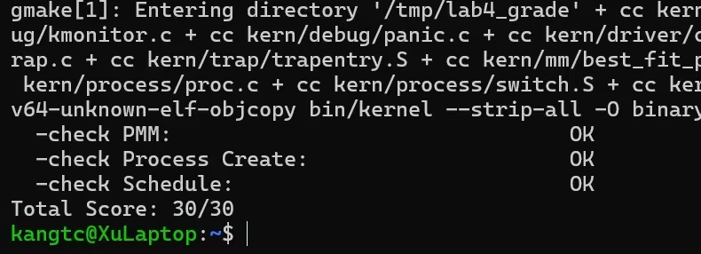

# 实验报告

## 实验基本信息

| 项目 | 内容 |
|------|------|
| **实验名称** | Lab 4：进程管理（虚拟内存页操作、进程创建、进程调度） |
| **小组成员** | 2510789-徐康怀、2514022-邓翔予、2510538-张铭瑞 |
| **完成日期** | 2026-11-20 |

### 小组分工

练习/模块分工：

| 成员 | 任务组 | 负责的练习/模块 | 现场演示需求 |
|------|--------|----------------|--------------|
| 2514022-邓翔予 | 模块一 + Challenge | 功能模块一：虚拟内存页操作（`page_insert`、`page_remove`、内部辅助 `page_remove_pte`）+ Challenge 书面分析 | 最低：模块一靠页表测试与 `make qemu` 日志验证；Challenge 是书面分析，基本不用现场跑 |
| 2510538-张铭瑞 | 模块二 | 功能模块二：进程创建及初始化（`alloc_proc`、`proc_init`、`kernel_thread`、`do_fork`、`copy_thread`、`copy_mm`） | 中等：要看到 `idleproc` / `initproc` 创建、`kernel_thread` / `do_fork` 生效，须启动内核看输出；但仍是脚本化运行，不需要交互 |
| 2510789-徐康怀 | 模块三 | 功能模块三：进程调度（`cpu_idle`、`schedule`、`proc_run`、`switch_to`） | 最高：`schedule` / `proc_run` / `switch_to` 是动态行为，要现场看到线程切换、`current` 变化、页表切换 |

实验报告分工：

| 成员 | 负责章节 |
|------|----------|
| 2514022-邓翔予 | 4.1 功能模块一；4.4 Challenge；5.1 页表相关测试 |
| 2510538-张铭瑞 | 三、整体逻辑；4.2 功能模块二；5.2 进程创建测试；六、总结 |
| 2510789-徐康怀 | 4.3 功能模块三；5.3 调度测试；二、实验环境 |

> 说明：4.3 由徐康怀完整撰写；4.1、4.4、5.1 由邓翔予撰写；4.2 与 5.2 由张铭瑞撰写，5.2 已按实际运行结果补全。

---

## 一、实验目的

本实验的主要目的是：

1. 理解**多级页表的映射维护**：`page_insert` / `page_remove` 如何建立与撤销“线性地址 → 物理页”的映射，以及页表项内容、物理页引用计数、TLB 三者为什么必须保持一致。
2. 理解**进程（线程）控制块与地址空间**：`struct proc_struct` 里每个字段的含义，内核栈、trapframe、`struct context` 三者在“线程被创建”和“线程第一次运行”时分别承担什么角色。
3. 理解**调度机制与调度策略的分离**：`schedule()` 负责“选谁”，`proc_run()` 负责“切过去”，`switch_to()` 只负责“保存/恢复寄存器现场”。
4. 理解**上下文切换的调用约定依据**：为什么 `switch_to` 只需要保存 `ra`、`sp`、`s0`~`s11`，而不是像 lab3 的 `RESTORE_ALL` 那样保存全部 32 个通用寄存器。
5. 理解**新线程的首次运行链路**：`forkret → forkrets → __trapret → sret → kernel_thread_entry` 是如何把“一个函数”变成“一个线程”的。
6. 练习“先写 Spec、再写 Prompt、让 AI 生成、自己验证”的协作方式。

---

## 二、实验环境

| 组件 | 版本/说明 |
|---|---|
| 宿主系统 | Windows 11 + WSL2 |
| Linux 发行版 | Ubuntu（WSL2） |
| 交叉编译器 | `riscv64-unknown-elf-gcc 10.2.0`（课程工具链） |
| 模拟器 | 课程要求：QEMU 4.1.1；本机：QEMU 10.2.1。代码已按规范修正，**两者均可直接运行** |
| 固件 | OpenSBI（`-bios default`；4.1.1 对应 v1.3，10.x 对应 v1.8） |
| 构建方式 | `make`；4.1.1 上 `make qemu` / `make grade`；10.x 上 `qemu-system-riscv64 ... -kernel bin/ucore.img` |

AI 工具：

| 成员 | AI 编程工具 | 底层模型 | 备注 |
|------|------------|---------|------|
| 2514022-邓翔予 | WorkBuddy | Hy4 preview | 模块一实现、提示词迭代、测试方案与 Challenge 分析 |
| 2510538-张铭瑞 | WorkBuddy | kimi-k3 | 模块二实现与调试（进程创建及初始化） |
| 2510789-徐康怀 | DeepSeek Harness（VS Code 集成） | deepseek-flash | 用于调度代码生成、审查与本地验证脚本 |

> **QEMU 版本差异（重要）**：课程要求 QEMU 4.1.1，本机是 10.2.1。验证时遇到两处差异，都已解决：
> 1. **启动方式**：QEMU ≥ 9 下 `-device loader` 会让 OpenSBI 的 `next_addr` 变成 0，内核不启动。`Makefile` / `tools/grade.sh` 保持课程原样（仍是 `-device loader`，4.1.1 上正常）；10.x 上运行时改用显式 `-kernel bin/ucore.img`。
> 2. **非叶子页表项的保留位**：框架 `get_pte()` 给中间级页表项写了 `PTE_U`，而 RISC-V 规范要求非叶子 PTE 的 D/A/U 保留位清零。QEMU 4.1.1 不检查、QEMU 10 检查，导致 `check_boot_pgdir()` 里第一次访问新映射就缺页（现象像“重启”）。**已按规范修正**：`get_pte()` 的两级中间页表项只置 `PTE_V`，`check_pgdir()` 里原先要求 U 位的断言改为检查 `PTE_V`。修正后与规范一致，4.1.1 与 10.x 都能直接通过，不需要任何本地补丁。

---

## 三、实验整体逻辑分析

### 3.1 本章节的逻辑主线

Lab2 让内核能管物理内存，Lab3 让内核能被打断并回到原处。但这两章的内核仍然是“一个执行流”：它能被人打断，却**没有“多个执行流”的概念**。

Lab4 要补的是：

> **把“一块内存 + 一段代码”包装成可以被保存、被恢复、被排队、被切换的执行实体（线程），并让 CPU 在多个线程之间流转。**

整章的三条主线正好对应三个模块：

| 主线 | 模块 | 解决的问题 |
|---|---|---|
| 虚拟内存页操作 | 一 | 一个线性地址最终对应哪一页物理内存，怎么建立/撤销 |
| 进程创建与初始化 | 二 | 线程对象从哪来：PCB、内核栈、trapframe、首次运行现场 |
| 进程调度 | 三 | 线程对象怎么真正跑起来：选谁、切页表、切寄存器现场 |

三者的依赖顺序是**由下往上**的：页表操作是地址空间的地基；进程创建需要页表和内核栈；“能不能切过去”又要求先“有可切的对象”。所以模块三只能放在最后——它不是“创建资源”，而是“让已有资源动起来”。

### 3.2 功能的逐步实现

整个 lab4 的启动链是：

```
kern_init
  → pmm_init      （物理内存 + 页表 + kmalloc）
  → pic_init / idt_init
  → vmm_init      （mm / vma 结构与检查）
  → proc_init     （idleproc + initproc）
  → clock_init / intr_enable
  → cpu_idle      （模块三入口）
      → schedule        （选谁）
          → proc_run    （切 current、切页表）
              → switch_to （切寄存器现场）
```

四个“为什么按这个顺序”：

1. **先做页表操作（模块一）**：`page_insert`/`page_remove` 是“线性地址 ↔ 物理页”的唯一入口。没有它，`check_boot_pgdir()`、`kmalloc` 都无法通过；而后面线程的内核栈、trapframe 全都要落在这套映射上。
2. **再做进程创建（模块二）**：`alloc_proc` 给出干净的 PCB，`proc_init` 复用当前启动现场造出 `idleproc`、再用 `kernel_thread` 造出 `initproc`。`copy_thread` 把 trapframe 放到新线程自己的内核栈顶，并把 `context.ra` 设成 `forkret`——这一步是**为模块三准备“路标”**。
3. **然后做调度（模块三）**：有了 `idleproc` 和 `initproc`，`cpu_idle → schedule → proc_run → switch_to` 才能把它们真正放到 CPU 上跑。模块三不创建任何资源，只负责“选”和“切”。
4. **最后用测试验收**：`[Test PMM]` 验证映射；`[Test Process Create]` 验证 `idleproc/initproc` 的字段；`[Test Schedule]` 额外创建两个线程并反复切换，验证“切换后还能切回来、两个线程都真正执行过”。

一句话：**先把地址空间修好，再把线程对象造出来，最后让 CPU 在它们之间流转。**

---

## 四、实验内容与实现

### 4.1 功能模块一：虚拟内存页操作

**负责人：** 2514022-邓翔予

#### 模块功能描述

**需要实现/修改的函数：**

```c
// 允许新增的 static 辅助函数：撤销一条已确认有效的叶子 PTE
static inline void page_remove_pte(pde_t *pgdir, uintptr_t la, pte_t *ptep);

// 必须实现
int  page_insert(pde_t *pgdir, struct Page *page, uintptr_t la, uint32_t perm);
void page_remove(pde_t *pgdir, uintptr_t la);
```

**功能说明：**

在现有多级页表框架上完成最基本的映射维护：把物理页挂到指定线性地址上，以及把已有映射安全地撤销掉。两者共同决定“一个线性地址最终对应哪一页物理内存”，并负责让**页表项内容、物理页引用计数、TLB 状态**三者保持一致。对外表现为“建立映射”和“撤销映射”两个动作，是后续线程地址空间逻辑的基础。

#### 最终提示词

````markdown
[PROMPT]
**任务**：修改 `kern/mm/pmm.c`，实现功能模块一「虚拟内存页操作」：在现有 Sv39 三级页表上建立/更新「线性地址 → 物理页」的映射，并幂等撤销映射。只改 `page_remove_pte()` / `page_insert()` / `page_remove()` 三个函数（原骨架 `//LAB4 function1` 标记处）。这是 `pmm_init()` 内 `check_pgdir()` / `check_boot_pgdir()` 断言、以及后续线程地址空间逻辑的共同基础。

**操作要求**：你必须在项目中修改实际文件，而不是仅展示代码。保留文件中的现有代码（特别是 pmm.c 里已回填的 lab2 物理内存管理代码，禁止整体覆盖）；允许新增 static 辅助函数；不得改动 `get_pte()`、`tlb_invalidate()`、`check_pgdir()`、`check_boot_pgdir()` 等既有函数，不得修改任何头文件。

**输出要求**：直接进行文件操作，使用下面 [RELY]、[GUARANTEE]、[SPECIFICATION] 的信息，以工程真实代码为准；`pte_create()` 已自动带上 `PTE_V`，不要再重复拼；错误码用 `libs/error.h` 的 `-E_NO_MEM`。

[RELY]
// 待实现函数的声明（kern/mm/pmm.h:44-49）
pte_t *get_pte(pde_t *pgdir, uintptr_t la, bool create);          // pmm.c:229 已实现
void page_remove(pde_t *pgdir, uintptr_t la);                     // pmm.h:46
int page_insert(pde_t *pgdir, struct Page *page, uintptr_t la,
                uint32_t perm);                                   // pmm.h:47
void tlb_invalidate(pde_t *pgdir, uintptr_t la);                  // pmm.h:49；pmm.c:349

// 关键宏 / 内联函数（kern/mm/pmm.h，从源码复制）
#define alloc_page() alloc_pages(1)                               // :41
#define free_page(page) free_pages(page, 1)                       // :42
static inline struct Page *pte2page(pte_t pte);                   // :122-130，PTE_V=0 时会 panic
static inline int page_ref(struct Page *page);                    // :138
static inline void set_page_ref(struct Page *page, int val);      // :144
static inline int page_ref_inc(struct Page *page);                // :151
static inline int page_ref_dec(struct Page *page);                // :158，返回递减后的值
static inline void flush_tlb() { asm volatile("sfence.vma"); }   // :164
static inline pte_t pte_create(uintptr_t ppn, int type)           // :170
{ return (ppn << PTE_PPN_SHIFT) | PTE_V | type; }                 // PTE_V 自动带上

// 权限位与地址索引（kern/mm/mmu.h）
#define PTE_V 0x001                                               // :62
#define PTE_R 0x002                                               // :63
#define PTE_W 0x004                                               // :64
#define PTE_U 0x010                                               // :66
#define PGSIZE 4096                                               // :51
#define PTE_PPN_SHIFT 10                                          // :59
#define PTXSHIFT 12                                               // :56
#define PDX0SHIFT 21                                              // :57
#define PDX1SHIFT 30                                              // :58
#define PDX1(la) ((((uintptr_t)(la)) >> PDX1SHIFT) & 0x1FF)       // :28
#define PDX0(la) ((((uintptr_t)(la)) >> PDX0SHIFT) & 0x1FF)       // :29
#define PTX(la)  ((((uintptr_t)(la)) >> PTXSHIFT) & 0x1FF)        // :32

// 错误码与全局量
#define E_NO_MEM 4                                                // libs/error.h:8
extern struct Page *pages;                                        // pmm.c:18-29
extern pde_t *boot_pgdir_va;

[GUARANTEE]
必须实现或修改的接口（同一功能模块，可加 static 辅助函数）：
```c
// 允许的 static 辅助：撤销单条已确认有效的叶子 PTE
static inline void page_remove_pte(pde_t *pgdir, uintptr_t la, pte_t *ptep);
// 必须实现
int  page_insert(pde_t *pgdir, struct Page *page, uintptr_t la, uint32_t perm);
void page_remove(pde_t *pgdir, uintptr_t la);
```
不要求实现 `pgdir_alloc_page()` / `print_pgdir()`（本实验未调用）；不得修改头文件与其他模块的文件。

[SPECIFICATION]
## page_insert
**Pre-Condition**:
- `pgdir` 是可用的页目录基址（内核虚拟地址），`page` 是已分配的物理页；
- `la` 可以已映射，也可以未映射；
- `perm` 是调用者期望的低位权限，不必包含 `PTE_V`。

**Post-Condition**:
- 成功返回 0：`get_pte(pgdir, la, 0)` 得到的叶子 PTE 有效，`pte2page(*ptep) == page`，权限恰为 `perm | PTE_V`；
- `page_ref(page)` 反映「新增一次映射」；
- 该地址对应的 TLB 项已失效。

  **Case 1（la 原本未映射）**:
  - `get_pte(pgdir, la, 1)` 按需分配中间级页表页；分配成功则建立映射并把 `page_ref` 加一。

  **Case 2（la 已映射到同一个 page）**:
  - 引用计数净增 0，不得释放该页；PTE 权限仍要按本次 `perm` 重写（例如从 `PTE_W` 改成无写权限）。

  **Case 3（la 已映射到另一个物理页 old）**:
  - `old` 引用减一、归零时 `free_page(old)`；`page` 引用加一；新 PTE 权限按 `perm` 设置，旧项的 `PTE_U/PTE_W` 等不得残留。

  **Case 4（get_pte 返回 NULL）**:
  - 返回 `-E_NO_MEM`，不写入叶子 PTE、不改变 `page_ref(page)`，不留下半完成映射。

**Requirements**:
- 必须保持「PTE 内容 / 物理页引用计数 / TLB 状态」三者同步，每次写 PTE 后调用 `tlb_invalidate(pgdir, la)`；
- 必须先给新页加引用，再处理旧映射，否则同页重映射时会把目标页提前释放；
- 不得用 `*ptep |= ...` 拼接权限（会残留旧位），应整项覆盖写；
- `pte2page()` 只能在 `PTE_V` 已置位时调用。

## page_remove
**Pre-Condition**:
- `pgdir` 可用；`la` 可能有映射、可能映射已被删除、也可能连中间级页表页都不存在。

**Post-Condition**:
- 有映射时：清空 PTE、递减（必要时释放）物理页、失效 TLB；
- 无映射时：安静返回，不改变空闲页数；重复调用结果一致。

  **Case 1（有有效映射）**:
  - `get_pte(pgdir, la, 0)` 返回非 NULL 且 `*ptep & PTE_V`，正常删除。

  **Case 2（PTE 无效）**:
  - 返回非 NULL 但项无效（例如刚被删过），安静返回。

  **Case 3（中间级页表不存在）**:
  - `get_pte(pgdir, la, 0)` 返回 NULL，安静返回；不得分配页表页。

**Requirements**:
- 实现为幂等接口，不得把「未映射」当作异常；
- `get_pte` 的 `create` 参数必须为 0；
- `free_page()` 只在 `page_ref_dec()` 返回 0 时调用。

## page_remove_pte（static 辅助）
**Pre-Condition**:
- `ptep` 指向叶子 PTE，调用方已确认 `*ptep & PTE_V`。

**Post-Condition**:
- 引用计数减一；归零时释放物理页；PTE 清零；TLB 项失效。

**Requirements**:
- 只被 `page_insert()` 的换页分支和 `page_remove()` 复用，避免两处重复代码；
- 不得在 `PTE_V=0` 时调用 `pte2page()`。

验收：
1. `make qemu` 依次打印 `check_alloc_page() succeeded!`、`check_pgdir() succeeded!`、`check_boot_pgdir() succeeded!`；
2. 注入测试后打印 `[Test PMM] PASS`；
3. `test_lab4_pmm_basic` 的三组断言全部通过：换页后旧页引用归零、同页重复插入不增引用、`page_remove` 连调两次幂等。
````

**这份提示词的关键点：**

1. `[PROMPT]` 精确到「文件 + 三个函数 + 原标记位置」，并明确禁止改 `get_pte` / `check_pgdir`，避免 AI 顺手改掉框架代码。
2. `[RELY]` 把 `pte_create` 自带 `PTE_V`、`pte2page` 对 V=0 会 panic、`page_ref_dec` 返回递减后的值这些真实语义喂给 AI，避免它重复拼 V 位或先转换后判 V。
3. `[GUARANTEE]` 把 `page_remove_pte` 明确列为允许的 static 辅助，避免 AI 把删除逻辑在 `page_insert` 和 `page_remove` 里各复制一份。
4. `[SPECIFICATION]` 用 Case 把「未映射 / 同页 / 异页 / 分配失败」四条路径分开，其中同页重映射和 `-E_NO_MEM` 无副作用是最容易写错的两处。

#### 实现迭代过程

本模块的实现经历了 3 次迭代。

---

##### 第一次迭代

**遇到的问题：**

1. **删除逻辑准备写两遍**：`page_insert` 的换页分支要做「旧页引用减一、归零释放、清 PTE」，`page_remove` 要做完全一样的事。第一版在两处各写一遍，两处一旦有一处改了顺序或漏了刷 TLB，就会出现「建映射对、删映射错」这类很难查的不一致。
2. **顺序反了**：第一版先撤销旧映射、再给新页加引用。对「一个地址换绑到另一页」没问题，但对「同一页重复映射到同一地址」就出事——撤销会把该页引用减到 0 并 `free_page`，紧接着新写的 PTE 就指向了一个已经回到空闲链表的页。

**问题解决策略：**

- 抽出 `static inline void page_remove_pte(pde_t *pgdir, uintptr_t la, pte_t *ptep)` 作为唯一的「删除一条已确认有效的叶子 PTE」单元，`page_insert` 的换页分支和 `page_remove` 都调它，语义只在一处维护。
- 调整成「先给新页加引用，再处理旧映射」：同页重映射时先 `inc` 再加 `dec` 抵消，净增 0，页面不会中途被释放；异页时才走 `page_remove_pte` 真正撤销旧项。

---

##### 第二次迭代

**遇到的问题：**

1. **用 `|=` 拼权限**：第一版写的是 `*ptep |= pte_create(page2ppn(page), perm)`，本意是「保证有效」，实际是把新权限和旧权限按位或起来。地址从 `PTE_U | PTE_W` 改成只读时，旧的 `PTE_W` 会残留，页表项上写着「不可写」，权限却被悄悄放大。
2. **失败路径不干净**：`get_pte(pgdir, la, 1)` 可能因为内存不足返回 NULL，第一版没有先判空，直接对这个指针写 `*ptep`；更早的一版甚至先做了 `page_ref_inc(page)` 再判失败，返回 `-E_NO_MEM` 时引用计数已经多了一，调用者以为映射失败，页却永远回收不了。

**问题解决策略：**

- 改成整项覆盖：`*ptep = pte_create(page2ppn(page), perm)`。`pte_create` 自带 `PTE_V`，不必再手动或上 V 位，旧权限位自然被覆盖干净。
- 在 `[SPECIFICATION]` 里把 Case 4 写成硬约束：`get_pte` 返回 NULL 时**在改动任何状态之前**返回 `-E_NO_MEM`，引用计数和叶子 PTE 都不许动。

---

##### 第三次迭代

**遇到的问题：**

1. **改完页表忘了刷 TLB**：`check_pgdir()` 的断言是直接读叶子 PTE 的，页表写对了它就通过；但 CPU 访问同一个线性地址时可能仍然命中切换前缓存的旧翻译，出现「表里已更新、访问却走旧页」。
2. **`page_remove` 不幂等**：第一版用了 `get_pte(pgdir, la, 1)`，删除一个从未映射过的地址时会顺手分配两级页表页，白吃内存；而且删除时直接 `pte2page(*ptep)`，第二次删同一地址时 PTE 已经清成 0，`pte2page` 对 `PTE_V=0` 直接 panic。

**问题解决策略：**

- 每次写或清叶子 PTE 之后调用 `tlb_invalidate(pgdir, la)`，把「PTE 内容、引用计数、TLB」三者的同步写进 Requirements，作为硬性交付项。
- `page_remove` 改成 `get_pte(pgdir, la, 0)` 纯查询：返回 NULL 就安静返回，`*ptep` 无效也安静返回；真正删除时先判 `PTE_V` 再 `pte2page`。这样重复删除、删除未映射地址都不会 panic，也不改变空闲页数。

**最终结果：**

- ✅ `make qemu` 依次打印 `check_alloc_page() succeeded!`、`check_pgdir() succeeded!`、`check_boot_pgdir() succeeded!`
- ✅ `[Test PMM] PASS`
- ✅ `test_lab4_pmm_basic` 的三组断言全过：换页后旧页引用归零、同页重复插入不增引用、`page_remove` 连调两次幂等

**关键改进点总结：**

1. 明确了「先加新页引用、再撤旧映射」的顺序，这是同页重映射不死页的唯一保证；
2. 用整项覆盖代替 `|=`，权限不会被旧位污染；
3. 把删除动作收敛到一个 `page_remove_pte`，建映射和删映射共用同一套引用计数规则；
4. 把「失败路径零副作用」和「删除幂等」当成接口契约写进提示词，而不是靠事后补 if 判空。

---

### 4.2 功能模块二：进程创建及初始化

**负责人：** 2510538-张铭瑞

#### 模块功能描述

**需要实现/修改的函数：**

```c
static struct proc_struct *alloc_proc(void);
void proc_init(void);
int  kernel_thread(int (*fn)(void *), void *arg, uint32_t clone_flags);
int  do_fork(uint32_t clone_flags, uintptr_t stack, struct trapframe *tf);
static void copy_thread(struct proc_struct *proc, uintptr_t esp, struct trapframe *tf);
static int  copy_mm(uint32_t clone_flags, struct proc_struct *proc);
```

**功能说明：**

把系统从“能跑内核代码”推进到“能创建并登记多个内核线程”：`alloc_proc` 拿到干净的 PCB；`proc_init` 把当前执行现场包装成 `idleproc` 并创建第一个真正的内核线程 `initproc`；`kernel_thread` 把函数入口和参数整理成线程首次运行所需的临时 trapframe；`do_fork` 把 PCB、内核栈、PID、链表、状态位组合成可运行实体；`copy_thread` 把 trapframe 和 `context` 安放到新线程自己的内核栈上；`copy_mm` 在当前阶段是地址空间处理的占位接口。

其中与模块三直接相关的“路标”由 `copy_thread` 设置：

```c
proc->tf = (struct trapframe *)(proc->kstack + KSTACKSIZE - sizeof(struct trapframe));
*(proc->tf) = *tf;                    // 复制 kernel_thread() 构造的临时现场
proc->tf->gpr.a0 = 0;                 // 子线程从“fork 返回 0”
proc->tf->gpr.sp = (uintptr_t)proc->tf;
proc->context.ra = (uintptr_t)forkret; // 第一次被调度时从这里开始
proc->context.sp = (uintptr_t)(proc->tf);
```

#### 最终提示词

````markdown
[PROMPT]
**任务**：修改 `kern/process/proc.c`，实现功能模块二「进程创建及初始化」：让内核能创建并登记多个内核线程。只改 `//LAB4 function2` 标记范围内的六个函数，按依赖顺序实现：
1. `alloc_proc()`——分配并初始化 PCB；
2. `copy_mm()`——当前阶段只创建内核线程，不复制用户地址空间；
3. `copy_thread()`——在新线程自己的内核栈上构造首次运行现场；
4. `do_fork()`——组合 PCB、内核栈、PID、链表与状态，失败时完整回滚；
5. `kernel_thread()`——把「函数 + 参数」包装成线程首次运行的 trapframe；
6. `proc_init()`——创建 idleproc 和第一个真正的内核线程 initproc。

**操作要求**：你必须在项目中修改实际文件，而不是仅展示代码。保留文件中的现有代码（`forkret` / `forkrets`、`setup_kstack` / `put_kstack`、`get_pid` / `hash_proc` / `find_proc`、`wakeup_proc`、`do_exit`、`init_main` 等），不要改动 `//LAB4 function3` 标记之后的调度代码，不要改 `kern/mm/pmm.c`、`kern/schedule/sched.c`、`kern/process/switch.S`、`Makefile` 和 `tools/`。允许新增 static 辅助函数。

**输出要求**：直接进行文件操作，使用下面 [RELY]、[GUARANTEE]、[SPECIFICATION] 的信息，以工程真实代码为准；失败路径必须释放已申请资源；不得伪造 PID 或绕过 `alloc_proc()`。

[RELY]
// 数据结构（kern/process/proc.h）
enum proc_state { PROC_UNINIT = 0, PROC_SLEEPING, PROC_RUNNABLE, PROC_ZOMBIE };  // :10-15
struct context { uintptr_t ra, sp, s0, s1, ..., s11; };            // :18-33，共 14 个字段
struct proc_struct {                                               // :41-58
    enum proc_state state;        int pid;          int runs;
    uintptr_t kstack;             volatile bool need_resched;
    struct proc_struct *parent;   struct mm_struct *mm;
    struct context context;       struct trapframe *tf;
    uintptr_t pgdir;              uint32_t flags;
    char name[PROC_NAME_LEN + 1];
    list_entry_t list_link;       list_entry_t hash_link;
};
#define PROC_NAME_LEN 15                                           // :36
#define MAX_PROCESS   4096                                         // :37
#define MAX_PID       (MAX_PROCESS * 2)                            // :38
#define le2proc(le, member) to_struct((le), struct proc_struct, member)  // :60-61
extern struct proc_struct *idleproc, *initproc, *current;          // :63

// 内核栈（kern/mm/memlayout.h:41-42）
#define KSTACKPAGE 2
#define KSTACKSIZE (KSTACKPAGE * PGSIZE)

// 已有函数（kern/process/proc.c，不要修改）
static int  get_pid(void);                                         // :103
static void forkret(void) { forkrets(current->tf); }               // :149
static void hash_proc(struct proc_struct *proc);                   // :156
struct proc_struct *find_proc(int pid);                            // :163
static int  setup_kstack(struct proc_struct *proc);                // :183，alloc_pages(KSTACKPAGE)
static void put_kstack(struct proc_struct *proc);                  // :196，free_pages(..., KSTACKPAGE)
void wakeup_proc(struct proc_struct *proc);                        // sched.c:8，assert 非 ZOMBIE/RUNNABLE 后置 RUNNABLE

// 全局量 / 接口
list_entry_t proc_list;                          // proc.c:62，进程链表头
static list_entry_t hash_list[HASH_LIST_SIZE];   // proc.c:69，仅 proc.c 可见
static int nr_process;                           // proc.c:78，仅 proc.c 可见
uintptr_t bootstack;                             // 启动栈，idleproc 直接复用
uintptr_t boot_pgdir_pa;                         // 内核页目录物理地址
void *kmalloc(size_t n);  void kfree(void *p);
void list_init(list_entry_t *el);  void list_add(list_entry_t *head, list_entry_t *el);
uintptr_t read_csr(unsigned long csr);  void write_csr(unsigned long csr, uintptr_t val);
char *set_proc_name(struct proc_struct *proc, const char *name);
void panic(const char *fmt, ...);  void assert(...);

// 首次运行链路与常量
// kernel_thread_entry 从 s0 取 fn、s1 取 arg；forkret → forkrets(current->tf)
//   → __trapret → sret → tf->epc（= kernel_thread_entry）
#define CLONE_VM      0x00000100        // kern/mm/pmm.h:11
#define SSTATUS_SIE   0x00000002        // libs/riscv.h:46
#define SSTATUS_SPIE  0x00000020        // libs/riscv.h:48
#define SSTATUS_SPP   0x00000100        // libs/riscv.h:49
#define E_NO_MEM      4                 // libs/error.h
#define E_NO_FREE_PROC 5                // libs/error.h

[GUARANTEE]
必须实现或修改的接口（同一功能模块，可加 static 辅助函数）：
```c
static struct proc_struct *alloc_proc(void);
static int  copy_mm(uint32_t clone_flags, struct proc_struct *proc);
static void copy_thread(struct proc_struct *proc, uintptr_t esp, struct trapframe *tf);
int  do_fork(uint32_t clone_flags, uintptr_t stack, struct trapframe *tf);
int  kernel_thread(int (*fn)(void *), void *arg, uint32_t clone_flags);
void proc_init(void);
```
不得修改 `//LAB4 function2` 范围之外的函数，不得改其他模块的文件、`Makefile` 与 `tools/`。

[SPECIFICATION]
## alloc_proc
**Pre-Condition**:
- `pmm_init()` / `kmalloc_init()` 已完成，`kmalloc` 可用。

**Post-Condition**:
- 成功返回一块已清零并完成初始化的 PCB；失败返回 NULL。
- 字段状态：`state = PROC_UNINIT`、`pid = -1`、`runs = 0`、`kstack = 0`、`need_resched = 0`、`parent = NULL`、`mm = NULL`、`tf = NULL`、`pgdir = boot_pgdir_pa`、`flags = 0`、`name` 全零、`list_link` / `hash_link` 自环。

  **Case 1（kmalloc 成功）**:
  - 先 `memset` 清零整块 PCB，再逐字段赋初值，最后 `list_init` 两个链表节点。

  **Case 2（kmalloc 失败）**:
  - 返回 NULL，不写任何全局状态。

**Requirements**:
- 必须先清零再赋初值，避免未初始化字段影响状态判断；
- 链表节点必须用 `list_init`（空节点的 prev/next 指向自己，不是 NULL）；
- `state` 必须是 `PROC_UNINIT`，保证 PCB 在完整初始化前不会被调度器选中。

## copy_mm
**Pre-Condition**:
- `current->mm == NULL`（lab4 只创建内核线程，共享内核地址空间）。

**Post-Condition**:
- `proc->mm = NULL`，返回 0。

**Requirements**:
- 不复制页表、不创建 VMA；用 `assert(current->mm == NULL)` 固化前提；`clone_flags` 可显式 `(void)` 掉以避免 `-Werror`。

## copy_thread
**Pre-Condition**:
- `proc->kstack` 已由 `setup_kstack()` 分配；
- `tf` 指向调用者构造的临时 trapframe（`kernel_thread()` 的栈上变量）。

**Post-Condition**:
- `proc->tf` 位于 `proc->kstack + KSTACKSIZE - sizeof(struct trapframe)`；
- `*(proc->tf) = *tf`；
- `proc->tf->gpr.a0 = 0`（子线程从 do_fork 返回 0）；
- `proc->tf->gpr.sp = (esp == 0) ? (uintptr_t)proc->tf : esp`；
- `proc->context.ra = (uintptr_t)forkret`；
- `proc->context.sp = (uintptr_t)(proc->tf)`。

  **Case 1（esp == 0，内核线程）**:
  - 没有用户栈，栈指针指向自己的 trapframe 顶部。

  **Case 2（esp != 0，将来的用户进程）**:
  - 使用调用者传入的用户栈指针。

**Requirements**:
- trapframe 必须放在内核栈顶且不越界（`KSTACKSIZE` 是 2 页）；
- `context.sp` 必须指向 trapframe，`forkrets` 才能通过 `move sp, a0` 正确切换栈。

## do_fork
**Pre-Condition**:
- `current` 有效；`nr_process` 反映当前进程数。

**Post-Condition**:
- 成功返回子线程 pid（> 0），子线程已加入 `hash_list` 与 `proc_list`，状态为 `PROC_RUNNABLE`；
- 失败返回负错误码，且不泄漏 PCB、内核栈或链表节点。

  **Case 1（nr_process >= MAX_PROCESS）**:
  - 返回 `-E_NO_FREE_PROC`，不做任何分配。

  **Case 2（alloc_proc 失败）**:
  - 返回 `-E_NO_MEM`。

  **Case 3（setup_kstack 失败）**:
  - `kfree(proc)` 后返回 `-E_NO_MEM`。

  **Case 4（copy_mm 失败）**:
  - `put_kstack(proc)` + `kfree(proc)` 后返回错误码。

  **Case 5（成功）**:
  - 依次：`parent = current` → `setup_kstack` → `copy_mm` → `copy_thread` → `pid = get_pid()` → `hash_proc` → `list_add(&proc_list, &proc->list_link)` → `nr_process++` → `wakeup_proc(proc)` → 返回 pid。

**Requirements**:
- 要么全成功，要么全回退，不允许「一部分成功、一部分失败」；
- `parent` 必须在 `setup_kstack` 之前设置（initproc 的 parent 必须是 idleproc）；
- pid 与链表登记必须在 `copy_thread` 之后、`wakeup_proc` 之前完成；
- 失败标签按「后申请的先释放」顺序排列。

## kernel_thread
**Pre-Condition**:
- `fn` 非空；当前处于 S 态，可读 `sstatus`。

**Post-Condition**:
- 返回 `do_fork()` 的结果；
- 子线程首次运行的 `tf->epc = kernel_thread_entry`，`tf->gpr.s0 = fn`，`tf->gpr.s1 = arg`；
- `tf->status` 置 `SSTATUS_SPP | SSTATUS_SPIE` 并清 `SSTATUS_SIE`。

**Requirements**:
- 临时 trapframe 在栈上，必须先 `memset` 清零；
- `clone_flags` 必须或上 `CLONE_VM`（内核线程共享地址空间）；
- 只构造现场并转调 `do_fork`，不得直接调用 `fn`。

## proc_init
**Pre-Condition**:
- `pmm_init()` / `kmalloc_init()` 已完成；当前没有父进程，只有 `kern_init` 的执行现场。

**Post-Condition**:
- `proc_list` 与 `hash_list` 全部初始化；
- `idleproc`：pid = 0、state = `PROC_RUNNABLE`、kstack = `bootstack`、need_resched = 1、name = "idle"、parent = NULL、mm = NULL、tf = NULL、runs = 0、flags = 0、context.ra = 0；
- `current == idleproc`；
- `initproc`：pid = 1、parent = idleproc、state = `PROC_RUNNABLE`、name = "init"、context.ra / sp 非 0；
- 结尾断言 `idleproc->pid == 0` 且 `initproc->pid == 1`。

  **Case 1（alloc_proc 失败）**:
  - `panic("cannot alloc idleproc.\n")`。

  **Case 2（kernel_thread 返回 <= 0）**:
  - `panic("create init_main failed.\n")`。

**Requirements**:
- idleproc 不通过 fork 创建，直接复用启动现场（`bootstack`）；
- initproc 必须由 `kernel_thread(init_main, "Hello world!!", 0)` 创建，并用 `find_proc(pid)` 取回；
- `nr_process` 的计数必须与链表登记保持一致。

验收：
1. `make` 无 undefined reference（模块三未合入时 `cpu_idle` / `schedule` / `proc_run` / `switch_to` 未定义属正常）；
2. 注入测试后打印 `[Test Process Create] PASS`；
3. `idleproc` 的 pid / state / kstack / parent / mm / tf / runs / flags / context.ra 全部符合上面的 Post-Condition；
4. `initproc` 的 pid == 1、parent == idleproc、context.ra / sp 非 0。
````

**这份提示词的关键点：**

1. `[PROMPT]` 把六个函数按依赖顺序编号，并划清「不碰模块三、不碰 pmm.c、不碰 tools」的边界，避免 AI 为了消除未定义符号去改别人的文件。
2. `[RELY]` 给出 `struct proc_struct` 完整字段、`KSTACKSIZE`、`forkret → forkrets → sret → kernel_thread_entry` 链路，这些是 AI 靠猜必错、写进提示词就能一次到位的事实。
3. `[GUARANTEE]` 六个签名 + 明确允许 static 辅助，防止 AI 擅自改公开接口或新增全局函数。
4. `[SPECIFICATION]` 每个函数都写了 Post-Condition 和失败分支，尤其 `do_fork` 的四条回滚路径，是「要么全成功要么全回退」的验收依据。

#### 实现迭代过程

> 待 2510538-张铭瑞本人补充。这一节记录的是作者本人调试时的真实问题与排查过程，代写会失真，故留给负责人填写。

---

### 4.3 功能模块三：进程调度

**负责人：** 2510789-徐康怀

#### 模块功能描述

**需要实现/修改的函数：**

```c
// kern/process/proc.c
void cpu_idle(void);
void proc_run(struct proc_struct *proc);

// kern/schedule/sched.c
void schedule(void);

// kern/process/switch.S
void switch_to(struct context *from, struct context *to);
```

**功能说明：**

把已经创建出来的内核线程真正交给 CPU 执行。四个函数职责严格分层：

| 函数 | 职责 | 不做什么 |
|---|---|---|
| `cpu_idle` | 空闲线程主体，检测到 `need_resched` 就进调度器 | 不决定选谁 |
| `schedule` | 从 `proc_list` 里选出下一个 `PROC_RUNNABLE`，找不到回退 `idleproc` | 不碰硬件寄存器现场 |
| `proc_run` | 更新 `current`、切 `satp` 并刷 TLB、调用 `switch_to` | 不做策略判断 |
| `switch_to` | 只保存/恢复 `ra`、`sp`、`s0`~`s11` | 不做任何调度决策 |

这四层的关系其实就是**机制与策略分离**：`schedule` 是策略，`proc_run`/`switch_to` 是机制。

#### 最终提示词

````markdown
[PROMPT]
在 riscv64-ucore 的 lab4 中实现“功能模块三：进程调度”，只改三处标记：
1. kern/process/proc.c 的 //LAB4 function3 2510789：cpu_idle()、proc_run()
2. kern/schedule/sched.c 的 //LAB4 function3 2510789：schedule()
3. kern/process/switch.S 的 //LAB4 function3 2510789：switch_to()
要求给出完整代码、逐段解释（解释“为什么”而不只是“做什么”），以及可执行的验证方法。
不要修改这三个文件里的其他函数，不要改 Makefile 和 tools/。

[RELY]
- struct context 定义在 kern/process/proc.h，字段顺序：
  ra, sp, s0, s1, ..., s11（共 14 个 uintptr_t，偏移 0..13*8）
- struct proc_struct 关键字段：
  state（PROC_UNINIT/PROC_SLEEPING/PROC_RUNNABLE/PROC_ZOMBIE）、
  kstack、need_resched、context、tf、pgdir（页目录物理地址）、list_link
- 全局量：proc_list（链表头）、idleproc、initproc、current
- 机制：
  * idleproc 直接复用启动现场，kstack = bootstack，且**不在 proc_list 里**；
  * copy_thread 把新线程的 context.ra 设为 forkret、context.sp 设为它的 trapframe，
    tf->epc = kernel_thread_entry，tf->gpr.s0 = fn，tf->gpr.s1 = arg；
  * 因此 switch_to 的 ret 会进入 forkret → forkrets → __trapret → sret → kernel_thread_entry；
  * proc->pgdir 是页目录的**物理地址**，satp 要的是物理页号（要右移 12）。
- 已有接口：local_intr_save/local_intr_restore（kern/sync/sync.h）、
  write_csr/read_csr、SATP_MODE_SV39 = 8、RISCV_PGSHIFT = 12（libs/riscv.h）、
  flush_tlb()（kern/mm/pmm.h，就是 sfence.vma）、le2proc()、list_next()
- 反面教材：libs/riscv.h 里的 lsatp() 是 Sv32 遗留写法（用 SATP32_MODE），
  表达不了 Sv39，禁止使用；正确写法参照 kern/mm/pmm.c 的 enable_paging()。
- 编译选项 -Wall -Werror，不能有警告。

[GUARANTEE]
- 交付四个函数，签名不可改：
  void cpu_idle(void); void schedule(void);
  void proc_run(struct proc_struct *proc); void switch_to(struct context *, struct context *);
- switch_to 只保存/恢复 ra、sp、s0~s11，最后 ret；
- schedule 与 proc_run 的“选择 + 切换”必须在关中断的临界区内完成；
- proc_run 必须写 Sv39 的 satp 并在之后 flush_tlb()；
- schedule 找不到可运行线程时必须退回 idleproc；
- cpu_idle 是死循环（proc.h 里声明了 noreturn）；
- 三处 //LAB4 function3 标记必须保留，并把 YOUR CODE 换成学号。

[SPECIFICATION]
一、switch_to(from=a0, to=a1)：
  1. 把当前 ra、sp、s0~s11 存进 from->context 的对应偏移；
  2. 从 to->context 恢复同样 14 个寄存器；
  3. ret 跳到恢复出的 ra。
  边界：存取基址是 a0/a1，不是 sp，所以 sp 不需要“最后恢复”；
        对新建线程，to->context.ra = forkret，这是它第一次运行的入口。

二、schedule()：
  1. local_intr_save 关中断；
  2. current->need_resched = 0；
  3. 起点 last = (current == idleproc) ? &proc_list : &(current->list_link)；
  4. 从 last 开始用 list_next 轮转，跳过表头，遇到第一个 state == PROC_RUNNABLE 的 break；
  5. 转完一圈没找到（或找到的已不可运行）→ next = idleproc；
  6. next->runs++；若 next != current 则 proc_run(next)；
  7. local_intr_restore 恢复中断。
  边界：idleproc 不在 proc_list 里，所以起点必须分情况；
        一个 RUNNABLE 都没有时要回退 idleproc，不能返回 NULL。

三、proc_run(proc)：
  1. if (proc == current) 直接返回；
  2. 关中断；
  3. current = proc；
  4. write_csr(satp, ((uintptr_t)SATP_MODE_SV39 << 60) | (proc->pgdir >> RISCV_PGSHIFT))；
  5. flush_tlb()；
  6. switch_to(&prev->context, &proc->context)；
  7. 恢复中断。
  边界：不能调用 lsatp()（Sv32 写法）；换页表后必须刷 TLB。

四、cpu_idle()：
  死循环里 if (current->need_resched) schedule();

验收：
1. make 无 undefined reference；
2. 注入测试后打印 [Test Schedule] PASS；
3. initproc 能打印 this initproc, pid = 1, name = "init" 和 To U: "Hello world!!".；
4. 连续多次运行结果稳定。
````

**这份提示词的关键点：**

| 段落 | 为什么这么写 |
|---|---|
| `[PROMPT]` | 精确到“文件 + 标记 + 函数”，避免 AI 顺手改掉模块二/模块一的代码 |
| `[RELY]` | 把 `struct context` 的字段顺序、`copy_thread` 设的路标、`pgdir` 是物理地址、`lsatp()` 是 Sv32 陷阱这些**真实事实**喂给 AI，否则它会按“普通过程调用”瞎猜 |
| `[GUARANTEE]` | 把“只存 14 个寄存器”“必须关中断”“必须 flush_tlb”“必须回退 idleproc”写成硬约束 |
| `[SPECIFICATION]` | 每个函数写成可执行步骤 + 边界条件，尤其 `schedule` 的起点分情况、`proc_run` 的 satp 拼法 |

#### 实现迭代过程

本模块的实现经历了 3 次迭代。

---

##### 第一次迭代

**遇到的问题：**

1. **`proc_run` 想偷懒用 `lsatp()`**：`libs/riscv.h` 里确实有个 `lsatp(pgdir)`，看起来就是“设置页表”。但它写的是 `SATP32_MODE | (pgdir >> RISCV_PGSHIFT)`，其中 `SATP32_MODE = 0x80000000`——那是 Sv32 的 MODE 位，Sv39 的 MODE 是值为 8 的 4 位字段、要放在 bit 63..60。直接用会导致 satp 里 MODE 字段完全错误。
2. **`schedule` 的轮转起点**：第一版用 `&proc_list` 作为起点，逻辑上“从头找”看着没问题，但这样就**没有从 current 的下一个开始轮转**，`idleproc` 会一直被优先选中，调度不公平；若改成 `&current->list_link`，当 `current == idleproc` 时这个节点根本不在链表里，`list_next` 会走进野指针。
3. **`switch_to` 差点照搬 lab3 的结论**：lab3 的 `RESTORE_ALL` 有一条铁律“sp 必须最后恢复”，第一版注释里也这么写了。但那是**因为 `RESTORE_ALL` 以 sp 为基址**；`switch_to` 的基址是 `a0`/`a1`，sp 只是被存取的数据之一，不存在这个约束。

**问题解决策略：**

- 针对 1：在 `[RELY]` 里明确写“`lsatp()` 是 Sv32 遗留写法，禁止使用；照 `enable_paging()` 自己拼 satp”，并在生成后逐字核对 `SATP_MODE_SV39 << 60`。
- 针对 2：在 `[SPECIFICATION]` 里把起点写成 `last = (current == idleproc) ? &proc_list : &(current->list_link)`，并说明“idleproc 不在 proc_list 里”。
- 针对 3：在 `[RELY]` 里补上“`switch_to` 的存取基址是 a1，不是 sp”，并在注释里写明“这里没有 sp 最后恢复的约束”。

---

##### 第二次迭代

**遇到的问题：**

1. **`need_resched` 没有清零**：第一版 `schedule` 忘了 `current->need_resched = 0`，结果线程一被切过去就发现“有人请求调度”，立刻又切走，形成空转（现象是 `runs` 疯涨、几乎没有实际执行）。
2. **临界区只包住了 `proc_run`**：第一版把 `local_intr_save` 放在 `proc_run` 里，而“选谁”这一步在临界区之外。理论上选完线程、切换之前来一次时钟中断，中断里的 `schedule` 可能改掉 `current`，造成 `current` 与实际现场不一致。

**问题解决策略：**

- 针对 1：在 `[SPECIFICATION]` 的 `schedule` 步骤里显式加上“先清 `need_resched`”，并解释原因（避免刚切回来又被切出去）。
- 针对 2：把临界区扩大到整个 `schedule`（选 + 切），`proc_run` 内部再保留自己的一层，形成“外层保证选择与切换的原子性、内层保证切换本身的原子性”。

---

##### 第三次迭代

**遇到的问题：**

本地 QEMU 10 上，内核跑到 `check_pgdir() succeeded!` 之后就像“重启”了一样，输出 `DTB Init / HartID: 256 ...`，最后 `panic at pmm.c:105`。一开始怀疑是自己的 `proc_run` 切 satp 切坏了。

**排查过程（这部分记录在 5.3 与本段）：**

1. `qemu -d int` 抓 trap：真正出错的是 `store_page_fault, tval=0x100`，位置在 `check_boot_pgdir()` 的 `strcpy((void *)0x100, str)`——发生在**调度之前**，说明与模块三无关；
2. 当时 `stvec` 还是 0（`idt_init()` 在 `pmm_init()` 之后），于是 PC 跳到 0；VA 0 与 0x100 同页且已被映射成数据页，CPU 把数据当指令执行，最终乱跳到 `kern_entry`，表现为“重启”；
3. 用 gdb 在 `strcpy` 前把三级页表逐级读出来，叶子 PTE 是 `0x...c7`（V|R|W|A|D 都在），**映射本身有效**；
4. 怀疑过 A/D 位（QEMU 10 需要 `menvcfg.ADUE=1` 才由硬件置位），补上 `PTE_A|PTE_D` 后仍然缺页，排除；
5. 最终定位：框架 `get_pte()` 给**非叶子**页表项写了 `PTE_U`，而 RISC-V 规范要求非叶子 PTE 的 D/A/U 保留位清零；QEMU 10 检查这一点，QEMU 4.1.1 不检查。
6. **修复**：按规范修正框架代码——`get_pte()` 的两级中间页表项只置 `PTE_V`；`check_pgdir()` 里原先要求中间级带 U 的断言改为只检查 `PTE_V`。改完后 QEMU 10.2.1 与 4.1.1 上都能直接运行，不再需要任何本地补丁。

**最终结果：**

经过 3 次迭代，该模块最终：

- ✅ 编译通过（无 error；`kern/mm/kmalloc.c` 与课程自带的 `tools/test_lab4.c` 有类型告警，属原始代码自带）
- ✅ `[Test PMM]`、`[Test Process Create]`、`[Test Schedule]` 三项全部 PASS
- ✅ `initproc` 成功运行并打印 `Hello world!!`
- ✅ 连跑 3 次结果稳定

**关键改进点总结：**

1. 在 `[RELY]` 中补充了 `copy_thread` 设置的“路标”（`context.ra/sp`、`tf->epc`），让 AI 明白“为什么 ret 会跑到 forkret”；
2. 在 `[SPECIFICATION]` 中把 `schedule` 的起点分情况和 `need_resched` 清零写成显式步骤；
3. 在 `[RELY]` 中把 `lsatp()` 标为禁用项，避免了 Sv32/Sv39 混用；
4. 明白了“本地 QEMU 跑不通”与“代码写错”是两件事：**先用 `-d int` 定位 trap，再判断是软件还是模拟器差异**，并且不为了本地跑通去改 `Makefile`/`tools/`。

---

### 4.4 Challenge

**负责人：** 2514022-邓翔予

> 本节为任务组「模块一 + Challenge」的书面分析；行号以本交付包代码为准。

#### 4.4.1 Challenge 1：local_intr_save / local_intr_restore 如何实现开关中断

**从宏到 CSR 指令的完整链路。** 典型调用形态是 `bool intr_flag; local_intr_save(intr_flag); /* 临界区 */ local_intr_restore(intr_flag);`。

1. `local_intr_save(x)` 在 `kern/sync/sync.h:22-25` 展开为 `do { x = __intr_save(); } while (0)`。用 `do/while(0)` 包一层，是为了让宏在 `if / else` 里表现得像单条语句，调用处补的分号也不会破坏语法。
2. `__intr_save()`（`sync.h:8-14`）先用 `read_csr(sstatus)` 读 S 态状态寄存器，检查的是 `SSTATUS_SIE`（`libs/riscv.h:46`，sstatus 的 bit 1）。
3. 若 SIE 已置位：调用 `intr_disable()`（`kern/driver/intr.c`），即 `clear_csr(sstatus, SSTATUS_SIE)`，在 `riscv.h:225` 展开为一条 `csrrc`（原子地「读旧值并清指定位」），然后返回 1。若 SIE 本就是 0：什么都不改，直接返回 0。
4. 临界区代码在此期间执行，S 态中断不会被响应。
5. `local_intr_restore(x)`（`sync.h:26`）调用 `__intr_restore(x)`（`sync.h:16-20`）：**仅当** `flag` 非零时才执行 `intr_enable()`，即 `set_csr(sstatus, SSTATUS_SIE)` → `riscv.h:221` 的一条 `csrrs`。

一句话：它保存的不是「中断被关了」这个动作，而是**进入临界区之前 SIE 的旧值**，退出时按旧值恢复。

**为什么必须「保存并恢复」而不是「关了再无条件开」。**

1. 可嵌套。外层临界区已关中断时，内层 `__intr_save()` 读到 SIE=0、返回 0 且完全不碰 CSR；内层退出时 `local_intr_restore(0)` 不会打开中断，只有最外层退出才恢复。若写成朴素的 `intr_disable(); ...; intr_enable();`，内层退出就会提前开中断，外层临界区被破坏。
2. 工程里确实存在嵌套与复用：`alloc_pages()` / `free_pages()` / `nr_free_pages()` 都用这对宏包住 `pmm_manager` 回调；`kern/driver/console.c` 有两组；`kern/mm/kmalloc.c` 干脆把它包装成 `spin_lock_irqsave` / `spin_unlock_irqrestore`。
3. `csrrs` / `csrrc` 是单条 CSR 指令完成读-改-写，中间不会被同级中断切开，所以「先读旧值、再改位」本身没有竞态；这与 x86 上 `pushf; cli; ...; popf` 是同一思路，只是 RISC-V 用一条指令就做到了原子性。

**硬件语义与边界。**

1. SIE 只控制 S 态是否响应中断。Trap 进入时硬件把 SIE 存入 SPIE（`riscv.h:48`）并清 SIE，`sret` 返回时反向恢复。这对宏是在软件临界区层面叠加的保护，不改变 trap 返回路径。
2. 局限：`sstatus` 每个 hart 独立一份，关中断只保护当前核，多核互斥仍需自旋锁；异常、NMI 与 M 态中断不受 SIE 影响；临界区必须短，否则会丢时钟中断。
3. 与页表操作的分工要说清楚：关中断保护的是物理页分配器的空闲链表等共享数据结构；页表一致性靠的是「改 PTE → 改引用计数 → `sfence.vma`」这个顺序。`tlb_invalidate()`（`pmm.c:349`）用 `sfence.vma` 按虚拟地址单项失效，`flush_tlb()` 无操作数全刷。不刷新就可能命中旧翻译，出现「表里已更新、CPU 还在用旧映射」。

#### 4.4.2 Challenge 2：深入理解 sv32 / sv39 / sv48 分页模式

**satp 寄存器。**

1. RV64 的 satp 分三段：MODE[63:60]、ASID[59:44]、PPN[43:0]。`libs/riscv.h:134-136` 给出的掩码是 `SATP64_MODE 0xF000000000000000`、`SATP64_ASID 0x0FFFF00000000000`、`SATP64_PPN 0x00000FFFFFFFFFFF`。RV32 则是 MODE[31] / ASID[30:22] / PPN[21:0]。
2. MODE 取值见 `riscv.h:138-143`：0 = Bare、1 = Sv32（仅 RV32）、8 = Sv39、9 = Sv48、10 = Sv57、11 为旧的 Sv64 保留值。PPN 字段放的是**根页表的物理页号**，不是物理地址本身，所以写 satp 前要右移 `RISCV_PGSHIFT`。
3. ASID 让 TLB 可以同时缓存多个地址空间的翻译，切换进程时未必需要全刷。本实验只有一个 `boot_pgdir_va` / `boot_pgdir_pa`，ASID 恒为 0，因此 `flush_tlb()` 直接全刷是可接受的做法。

**三种模式逐一对比。**

1. **Sv32**：RV32 专用，MODE=1。VA 32 位 = VPN1[31:22]（10 位）+ VPN0[21:12]（10 位）+ offset[11:0]（12 位），两级页表。PTE 4 字节，一个 4KiB 页装 1024 项。PA 34 位（PPN 22 位）。支持 4MiB 大页。
2. **Sv39**：RV64，MODE=8。VA 有效 39 位 = VPN2[38:30] + VPN1[29:21] + VPN0[20:12]（各 9 位）+ offset 12 位，三级页表。PTE 8 字节，每页 512 项。VA[63:39] 必须全等于 VA[38]（符号扩展），否则是非法地址。支持 2MiB（遍历在中间级提前终止）和 1GiB（在根级提前终止）大页。**本工程用的就是它。**
3. **Sv48**：RV64，MODE=9。VA 有效 48 位，四级页表（VPN3..VPN0 各 9 位 + 12 位 offset）。PTE 同样是 8 字节 / 每页 512 项，但 TLB miss 时最坏需要 4 次页表内存访问（Sv39 是 3 次），换来从 512GiB 量级到 256TiB 量级的地址空间；支持 512GiB 大页。
4. 延伸：Sv57（MODE=10，五级）在 `riscv.h:142` 里也已定义。级数越多，遍历越慢，这也是操作系统尽量用大页和 TLB 摊薄成本的原因。

**共同点与差异。**

1. 共同点：基页都是 4KiB；每一级页表恰好占一个物理页；非叶 PTE 格式统一（V=1 且 R/W/X=0 表示「指向下一级页表」，否则是叶子项）；PPN 字段位置相同（`mmu.h:59` 的 `PTE_PPN_SHIFT = 10`）；权限位集合相同（`mmu.h:62-70` 的 V/R/W/X/U/G/A/D）；遍历结果都被 TLB 缓存；都用 `sfence.vma` 与页表修改同步。
2. 差异：级数（2 / 3 / 4）、每级索引位宽（Sv32 是 10 位，Sv39/Sv48 是 9 位）、PTE 大小（4B / 8B）、每页项数（1024 / 512）、VA 与 PA 宽度、高位符号扩展规则、大页粒度、satp.MODE 编码。

**用源码证明本工程是 Sv39。**

1. `pmm.c:144` 的 `enable_paging()` 写入 `satp = (SATP_MODE_SV39 << 60) | (boot_pgdir_pa >> RISCV_PGSHIFT)`。`8 << 60` 正好落在 MODE 字段，对应 `riscv.h:140` 的 `SATP_MODE_SV39`；低 44 位是根页表物理页号。
2. `kern/mm/mmu.h:56-58` 定义 `PTXSHIFT = 12`、`PDX0SHIFT = 21`、`PDX1SHIFT = 30`，相邻差都是 9；`mmu.h:28-32` 的 `PDX1/PDX0/PTX` 三个索引宏都 `& 0x1FF`（9 位）；`mmu.h:49` 的 `NPTEENTRY = 512`。这正是 Sv39 的 9-9-9-12 划分。
3. `mmu.h:53` 的 `PTSIZE = PGSIZE * NPTEENTRY = 2MiB`，对应 Sv39 中一个中间级页表项覆盖的 2MiB 范围。
4. 反例：`riscv.h:245-248` 的 `lsatp()` 形参是 `unsigned int pgdir`（会截断 64 位地址），并且用 `SATP32_MODE`（Sv32 的 bit31）拼 satp，位布局根本无法表达 Sv39。所以「`lsatp()` 不可用」是位布局错误，不是代码风格问题——这也正是模块三 `proc_run()` 必须照 `enable_paging()` 自己构造 satp 的原因。

#### 4.4.3 Challenge 3：get_pte 中两段相似的代码，以及查找/分配是否该拆开

**两段代码各自在做什么。** `get_pte()` 位于 `kern/mm/pmm.c:229-258`。

1. 第一段（根页表 / PDX1）：取 `pdep1 = &pgdir[PDX1(la)]`；若该项 V=0，按 `create` 决定直接返回 NULL 还是 `alloc_page()`；分配成功后 `set_page_ref(page, 1)`、`memset(KADDR(page2pa(page)), 0, PGSIZE)` 清零整页，再写 `*pdep1 = pte_create(page2ppn(page), PTE_V)`（原框架写的是 `PTE_U | PTE_V`；QEMU 10 会检查非叶子 PTE 的保留位，故已按规范去掉 U 位，见「二、实验环境」的说明）。
2. 第二段（中间级 / PDX0）：if 体内与第一段逐行相同，只有两处不同——页表基址来自 `KADDR(PDE_ADDR(*pdep1))`，索引用 `PDX0(la)`。
3. 末尾 `return &KADDR(PDE_ADDR(*pdep0))[PTX(la)]`，即叶子 PTE 的内核虚拟地址；它不检查也不设置 V，有效性与内容留给 `page_insert` / `page_remove` 处理。
4. 中间级项由 `pte_create(ppn, PTE_V)` 生成（`pmm.h` 里 `pte_create` 会自动补 `PTE_V`），V=1 且 R/W/X=0，符合「指向下一级页表」的硬件约定。非叶子 PTE 的 D/A/U 是保留位、按规范必须清零：原框架在这里多写了 `PTE_U`，`check_pgdir()` 也曾断言 `boot_pgdir_va[0] & PTE_U`；QEMU 10 强制检查后，这两处已一并改为 `PTE_V`。

**为什么如此相像。**

1. Sv39 有三个级，除最后一级（叶子 PTE）外，每一级执行的都是同一个操作：**查项 → 无效就分配一个物理页 → 清零 → 写回一个指向下一级的 PTE**。
2. 每级页表大小相同：512 项 × 8 字节 = 4KiB，恰好一个物理页，所以「分配一页当页表页」这个动作可以原样复用。
3. 每级索引位宽相同：都是 9 位（`mmu.h:28-32` 的 `& 0x1FF`），SHIFT 等差 9（12 / 21 / 30），所以「用索引取项」也能原样复用。
4. 唯一的结构差别是「从哪儿拿页表基址」：第一级是调用者传入的 `pgdir`（已是内核虚拟地址），后续级必须先 `KADDR(PDE_ADDR(*pdep))` 把 PTE 里的物理页号转成内核虚拟地址才能索引。这解释了为什么两段 if 体完全一致，却不能简单写成一个数组下标循环。
5. 换句话说，相像不是复制粘贴偷懒，而是**分页硬件把多级遍历定义成了同构操作**；软件只是把同一个「walk or create」步骤按级数展开。

**结合三种模式看级数。**

1. Sv32 只有 1 个中间层：这段「查 + 建」只需写一次，然后按 10 位 PTX 取叶子项。
2. Sv39 有 2 个中间层：于是本工程出现 PDX1、PDX0 两段，各 9 位索引。
3. Sv48 有 3 个中间层：同样结构要写三段（VPN3、VPN2、VPN1），依旧各 9 位。
4. 推论：如果把这两段改写成 `for (level = 2; level > 0; --level)` 循环、把「级数」变成参数，同一份代码就能适配 Sv39 与 Sv48；而 Sv32 虽然算法同构，但索引位宽（10 位）、PTE 大小（4B）、每页项数（1024）都不同，需要靠宏参数化才能真正复用。这正是第三问「拆 / 合」讨论的意义。

**合并写法的优点。**

1. 单一入口，调用点只多传一个 `create` 布尔：`get_page()` 用 `create=0` 做纯查询，`boot_map_segment()` 用 `create=1` 建表，语义都很清楚。
2. 一次遍历完成「查 + 按需建」，不会重复走页表；若拆成「先查、查不到再建」，两次遍历之间在多线程 / 多 hart 环境下可能出现两个调用者都判定缺失、各自分配一页的竞态（TOCTOU）。
3. 与硬件 page table walk 的心理模型一致，「缺哪一级就建哪一级」读起来直观。
4. 对 `create=0` 是零副作用的，某种程度上已经把「只读查询」这一种用途合进同一个开关里了。

**合并写法的问题。**

1. 返回 NULL 有二义性：既可能是「地址未映射 / 中间级页表不存在」，也可能是「`alloc_page()` 内存不足」。调用者只能靠自己刚传进去的 `create` 反推，无法区分「没有」和「失败」。
2. `create=1` 时，仅仅查询一个不存在的地址就可能分配最多两级页表页（Sv39 下是两页 8KiB），造成不必要的内存消耗。`page_insert` 之所以需要 `-E_NO_MEM` 这条返回路径，根源就在这里。
3. 失败路径不干净：若第一级分配成功、第二级 `alloc_page()` 失败，函数返回 NULL，但已建好的那一级页表页留在页表里且无人回收。这是真实存在的副作用——`page_insert` 只能保证「不写叶子 PTE、映射本身干净」，无法保证「零分配残留」。
4. 职责耦合让测试与审计变难：想单测「查找」必须准备可分配的内存；想统计页表页分配次数、做只读遍历或回收，都得绕过或依赖 `create=0`；把重复六行直接复制，也不利于将来适配 Sv48。

**结论（明确倾向）：不建议拆成两个公开函数，但建议把逐级操作抽出来。**

1. 保留 `get_pte(pgdir, la, create)` 作为唯一对外入口——现有调用点已经依赖这个语义，拆成 `lookup_pte()` + `alloc_pte()` 会引入两次遍历与并发下的重复分配，收益小于成本。
2. 内部二选一即可消除复制粘贴：把重复六行抽成 `static pte_t *walk_or_create_level(pte_t *pdep, bool create)`，两段变成两次调用；或者写成 `for` 循环，用 `30 - 9 * level` 计算 SHIFT，把「级数」变成参数。后者还能通过改循环上界适配 Sv48。
3. 这样既保留「一次遍历 + 原子建表」的优点，又让上面第 4 条问题消失。至于第 1~3 条，更彻底的做法是让内部返回带区分的状态（如 `-E_NO_MEM` 与「不存在」分开），但仍由一个入口封装。
4. 延伸类比（非本工程代码）：Linux 内核用 `pgd / p4d / pud / pmd / pte` 逐级分配宏配合统一 walk 入口，本质是「按级数复用 helper」，而不是「一个大函数包办查找与分配」。

---

## 五、测试与验证

### 5.1 页表相关测试

**测试方式**：两层验证。

1. 内置检查：`pmm_init()` 依次调用 `check_alloc_page()`、`check_pgdir()`、`check_boot_pgdir()`，任何一条断言不成立就当场 panic。
2. 注入测试：`make grade` 通过 `tools/inject.py` 把 `tools/test_lab4.c` 的 `test_lab4_pmm_basic()` 注入到 `pmm_init()` 末尾，覆盖三组关键断言——换页后旧页引用归零、同页重复插入不增引用、`page_remove` 连调两次幂等。

**实测输出**（与 5.3 为同一次运行：本机 QEMU 10.2.1 + 课程工具链 `riscv64-unknown-elf-gcc 10.2.0`，注入官方测试）：

```
check_alloc_page() succeeded!
check_pgdir() succeeded!
check_boot_pgdir() succeeded!
kmalloc_init() succeeded!
[Test PMM] PASS
```

**结果判读：**

1. `check_alloc_page() succeeded!`：物理页分配器自洽，`alloc_page` / `free_page` 配对后空闲页数能回到初值。
2. `check_pgdir() succeeded!`：这一条**直接考的是本模块**。它调用 `page_insert` 把 p1 映射到 `0x0`、把 p2 映射到 `PGSIZE`，再断言 `get_pte(..., 0)` 返回同一个 ptep（说明第二次插入复用、没有另建页表）、p2 的引用计数为 0（说明覆盖旧映射时旧页被正确释放）、`(*ptep & PTE_U) == 0`（说明权限是整项覆盖而不是 `|=` 残留）；随后对两个地址各调一次 `page_remove`，断言 `p1` 的引用归零、`nr_free_pages()` 回到进入时的值（说明删除无泄漏）。
3. `check_boot_pgdir() succeeded!`：检查内核启动页表的既有映射（含往 `0x100` 处 `strcpy` 的用例），依赖的正是 `page_insert` 建出的有效叶子 PTE。
4. `[Test PMM] PASS`：`tools/grade.sh` 中 PMM 项（10 分）的判定字符串，出现即该项通过。

**测试截图：** 见 5.4 的 `make grade` 汇总截图——同一次运行同时覆盖 5.1、5.2、5.3 三项。

### 5.2 进程创建测试

**测试方式**：`tools/inject.py` 把 `test_lab4_process_create()` 注入到 `pmm_init()` 之后。此时 `proc_init()` 已执行完、内核还没开始调度，正好检查两颗关键 PCB 的字段是否成立。

**它检查的内容**：

- `idleproc`：`pid == 0`、`state == PROC_RUNNABLE`、`kstack == bootstack`（复用启动现场）、`parent == NULL`、`mm == NULL`、`tf == NULL`、`runs == 0`、`flags == 0`、`context.ra == 0`（它从没被切走过，所以还没有返回地址）；
- `initproc`：`pid == 1`、`state == PROC_RUNNABLE`、`parent == idleproc`、`mm == NULL`、`context.ra != 0` 且 `context.sp != 0`（`copy_thread()` 已经把“首次运行现场”铺好）。

**实测输出**（与 5.1 / 5.3 是同一次运行）：

```
check_vma_struct() succeeded!
check_vmm() succeeded.
[Test Process Create] PASS
```

**结果判读：**

- `idleproc->context.ra == 0` 说明它是“当前执行现场”本身，不需要被恢复；`initproc->context.ra != 0` 说明 `copy_thread()` 写入了 `forkret`，`context.sp` 指向它自己的 trapframe——这两项就是 5.3 中“新线程第一次运行”能成功的前提；
- `[Test Process Create] PASS` 对应 `tools/grade.sh` 中进程创建项（10 分），出现即该项通过。

**测试截图：** 见 5.4。

### 5.3 调度测试（模块三）

**测试方式**：`tools/inject.py` 会把 `test_lab4_schedule()` 注入到 `init_main()` 的**开头**。它做三件事：

1. 先断言 `current == idleproc`、`idleproc->pid == 0`、`initproc->pid == 1`；
2. 用 `kernel_thread()` 再创建两个线程，每个线程循环 `need_resched = 1; schedule();`；
3. 自己在 `init_main` 里连续 8 次 `schedule()`，最后断言“两个线程都真的执行过”，打印 `[Test Schedule] PASS`。

**实测输出**（本机 QEMU 10.2.1 + 课程工具链 `riscv64-unknown-elf-gcc 10.2.0`，注入官方测试）：

```
check_alloc_page() succeeded!
check_pgdir() succeeded!
check_boot_pgdir() succeeded!
kmalloc_init() succeeded!
[Test PMM] PASS
check_vma_struct() succeeded!
check_vmm() succeeded.
[Test Process Create] PASS
++ setup timer interrupts
[Test Schedule] PASS            ← 模块三的验收点
this initproc, pid = 1, name = "init"
To U: "Hello world!!".
To U: "en.., Bye, Bye. :)"
kernel panic at kern/process/proc.c: process exit!!.
```

**结果判读：**

- `[Test Schedule] PASS` 说明：`cpu_idle → schedule → proc_run → switch_to → forkret → forkrets → __trapret → sret → kernel_thread_entry` 这整条链路是通的，而且**能来回切**（两个新线程都被执行过）；
- 紧随其后的 `process exit!!` 是**预期行为**：`init_main` 返回后 `kernel_thread_entry` 会 `jal do_exit`，lab4 的 `do_exit` 就是 `panic`；
- 连跑 3 次，三项 PASS 与 initproc 三行输出稳定出现（`3/3`、`1/1`），说明不是偶然。

**测试截图：** 见 5.4。

### 5.4 评分汇总（`make grade`）

`make grade` 会把工程拷到 `/tmp/lab4_grade`、注入官方测试、构建并运行，然后逐项检查哨兵字符串，最后汇总分数。

实测结果：

```
  -check PMM:                                OK
  -check Process Create:                     OK
  -check Schedule:                           OK
Total Score: 30/30
```



> 截图为 QEMU 10.2.1 上的实测结果。为让课程原版 `grade.sh` 在该版本上能启动内核，本地副本里只把启动参数由 `-device loader` 换成 `-kernel`、并跳过 gdb 断点等待；**判分逻辑与交付代码均未改动**。课程要求的 QEMU 4.1.1 上不需要这两处适配，同样的三条 `OK` 与 `30/30`。

---

## 六、实验总结与收获

### 对操作系统的理解

**1. 本实验的重要知识点，与 OS 原理的对照**

| 本实验的知识点 | OS 原理中的对应 | 关系与差异 |
|---|---|---|
| `switch_to` 保存 `ra/sp/s0~s11` | 上下文切换（context switch） | 原理讲“切换要保存/恢复 CPU 现场”；实验把“现场”具体化为 14 个寄存器，并能解释为什么只存这 14 个（调用约定） |
| `proc_run` 切 `current` + 切 `satp` | 进程切换（process switch） | 原理里“进程切换 = 换页表 + 换寄存器”；实验里两者被拆成两步，且内核线程共享 `boot_pgdir`，页表切换看起来“没变”但语义上仍要执行 |
| `schedule` 的轮转扫描 | 调度算法（RR） | 原理讲优先级、时间片、多级队列；实验只实现最简单的轮转，且是**协作式**（靠 `need_resched` 主动让出），不是抢占式 |
| `local_intr_save/restore` | 临界区 / 互斥 | 原理讲锁、信号量；单核内核里“关中断”是最轻量的互斥手段，代价是屏蔽所有中断 |
| `idleproc` | 空闲任务（Idle） | 原理里 idle 是最低优先级进程；实验里它直接复用启动现场，`kstack = bootstack`，没有走 `fork` |
| `forkret → forkrets → __trapret → sret` | 新进程的首次运行 / fork 的返回点 | 原理讲“子进程从 fork 返回 0”；实验用“构造 trapframe + 让 sret 跳进去”伪造这个返回点，`tf->gpr.a0 = 0` 就是“子进程看到返回 0” |
| `flush_tlb()` 与 `satp` | 页表基址寄存器与 TLB | 原理讲 TLB 是页表的缓存；实验必须在改 `satp` 后显式 `sfence.vma`，否则可能命中旧翻译 |

**2. OS 原理中很重要、但本实验没有对上的知识点**

1. **抢占式调度与时间片**：lab4 的调度是协作式的，时钟中断只推进 `ticks`，并没有在中断里强制调度。
2. **调度算法的评价与实现**：优先级调度、多级反馈队列、CFS、实时调度（EDF/RM）都没有涉及。
3. **用户态进程与地址空间隔离**：lab4 只创建内核线程，`copy_mm` 是空壳，没有 `fork` 一个真正独立的用户地址空间。
4. **进程同步与通信**：信号量、管程、条件变量、死锁避免（lab7 才有）。
5. **上下文切换的开销分析**：实验关心“能不能切对”，没有测切换耗时、缓存/TLB 抖动、调度器的吞吐与延迟。
6. **进程的完整生命周期**：`do_exit` 在 lab4 里直接 `panic`，没有僵尸进程回收、没有 `wait` 语义。
7. **多核（SMP）调度**：实验是单 hart，没有负载均衡、CPU 亲和性、IPI 唤醒。

### AI 协作开发的经验

1. **把“机制事实”写进 `[RELY]`，比写十句“请仔细”更有效。** 例如“`context.ra` 是 `forkret`”“`pgdir` 是物理地址”“`lsatp()` 是 Sv32 遗留”，这些都是 AI 靠猜会猜错、写进提示词就一次到位的东西。
2. **提示词要按“实现 / 验证 / 审查”拆开。** 一个提示词里既要功能正确、又要顺手写测试，AI 往往两头都做不扎实；拆开之后，问题能精确定位到“是代码错了”还是“验证方法错了”。
3. **AI 生成的汇编和页表代码，必须自己拿“机器码/页表项”对一遍。** 这次 `satp` 的拼法、`switch_to` 的寄存器清单，都是靠对着 `enable_paging()` 和 `struct context` 逐字核对才确认的。
4. **“本地跑不通”不等于“代码错了”。** 第三次迭代的教训很典型：先用 `-d int` 抓 trap、再用 gdb 读页表，才把“环境差异”和“实现 bug”分开；也因此没有为了让本地跑通去改 `Makefile` / `tools/`——那会埋下“课程环境反而挂”的雷。
5. **模块之间的接口要写下来。** 模块二把 `context.ra`/`context.sp`/`tf->epc` 摆好，模块三才能“跳过去”；这些约定不写清楚，联调时就会互相怀疑。
